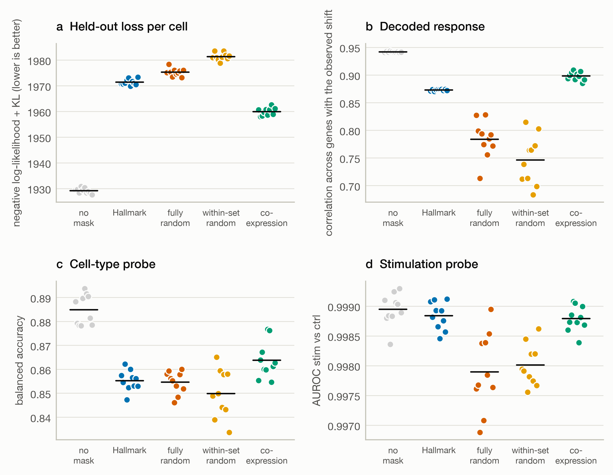

# Knowledge or sparsity? Gene set masks in a single-cell VAE


*Control and IFN-β-stimulated blood cells enter a VAE whose linear decoder is restricted by a binary mask (stages 1 and 2). In
stage 3, rows are the 12,034 genes sorted by Hallmark membership, columns are the 58 latents (50 named, then 8 free), and
each dot is a link kept by the mask of seed 0. The fully random mask also shuffles genes that are in no set; the within-set
random mask leaves them in place. In stage 4, each dot is the correlation of the decoded and the observed stimulation shift
across genes for one of the 10 seeds of a variant, and the diamond and the number give the mean.*

**Contents**

- [Background](#background)
- [Methods](#methods): [study design](#study-design), [data](#data), [gene sets and masks](#gene-sets-and-masks),
  [model](#model), [evaluation](#evaluation)
- [Results](#results): [Q1](#q1-knowledge-or-sparsity), [Q1d](#q1d-reactome-and-the-oesinghaus-data), [supplementary results](docs/supplementary.md)
- [Limitations](#limitations) · [Reproducing](#reproducing) · [Future work](#future-work) · [Use of generative AI](#use-of-generative-ai) · [References](#references)

## Summary

Restricting the decoder to gene sets makes the model fit worse. The Hallmark sets recover part of that loss compared with random sets, largely through the strongest response genes. Groups of genes that are expressed together in the data do as well or better. The comparison is repeated with Reactome sets and on two cytokine stimulations of a second data set, and the results differ between collections and stimuli.

**At a glance**

- **Question:** in a single-cell RNA-seq variational autoencoder (VAE) [37] restricted to gene sets, does the biological knowledge in the sets or the sparsity they impose explain how well it captures a known response?
- **Data:** blood cells (PBMCs) from 8 lupus patients, with and without interferon-β stimulation (Kang et al. [17]; 23,919 cells, 12,034 genes). A second data set, the cytokine dictionary of Oesinghaus et al. [41] (12 healthy donors, 24 h), supplies interferon-β and interleukin-2 against an unstimulated control (28,800 cells and about 11,340 genes each).
- **Response:** the shift in gene expression that IFN-β (a type I interferon) causes between control and stimulated cells, which the decoder should reproduce.
- **Model:** VAE with a linear decoder. A binary mask on the decoder weights limits which genes each latent variable can reach. There are 5 variants:
  - no mask
  - Hallmark collection of MSigDB v2024.1
    - 50 sets refined from founder sets for coherent expression (e.g. interferon response, hypoxia, inflammation)
    - its interferon-α response set is the matching biological target of the response
  - two random masks of the same sparsity, shuffling the labels of
    - all genes
    - only genes in a set
  - mask of groups of co-expressed genes based on the data.
- **Gene set collections:** Hallmark, and Reactome (50 sets chosen by size, overlap and pathway hierarchy, never from expression).
- **Evaluation:** four measures that choose no latent (test loss, decoded stimulation shift, cell-type probe, stimulation probe), 10 seeds. The interferon-α latent score, learning curves and a repeat of the comparison without the 250 strongest stimulation genes are in the [supplementary results](docs/supplementary.md).
- **Limitations:** one dataset with one very strong response, so the stimulation probe is at its ceiling (AUROC 0.998–0.999 for every variant) and cannot rank variants or show a data-efficiency benefit; each condition was sequenced in a single run, so a run effect cannot be separated from the stimulation.

**Key findings**

- Sparsity has a cost: every masked variant has a higher test loss, reproduces the stimulation response less well and separates cell types less well than the no-mask VAE.
- Biological knowledge recovers part of that cost: the Hallmark mask has a lower test loss and reproduces the response better than random masks of the same sparsity.
- Knowledge does not improve the cell-type representation: the Hallmark mask does not score higher than the random masks on cell-type balanced accuracy.
- Groups of co-expressed genes found in the data fit and reproduce the response better than Hallmark sets; only the Hallmark sets give each latent a biological name chosen before training, such as "interferon-α response".
- The interferon-α latent of the Hallmark mask carries the response, whereas a random mask's latent at that position does so unreliably (supplementary S1).
- The Hallmark advantage over random masks rests largely on the strongest response genes: after they are dropped it disappears against the fully random mask and falls to a fifth against the within-set random mask (supplementary S4).
- Across the six benchmarks (Hallmark and Reactome on Kang IFN-β and on Oesinghaus IFN-β and IL-2), the masked decoder reproduces the stimulation shift better than both random masks and worse than the co-expression mask. It has a lower test loss than the within-set random mask in all six and than the fully random mask in four (not for Hallmark on the Oesinghaus data).
- Collections and stimuli differ. The Reactome mask beats the fully random mask on test loss by 8.5 to 10.8 units in all three contrasts, where Hallmark does so only on Kang. The Hallmark advantage in decoded response is larger than the Reactome one on both Oesinghaus contrasts and smaller on Kang. These are descriptive comparisons of two draws of sets (Limitations), not a ranking of the collections.
- For IL-2 the known-answer latent does not follow the stimulation (AUROC 0.44 to 0.50 for the Hallmark and Reactome IL-2 sets), although a free latent of the same models does (0.80 to 0.83): the response in this contrast is dominated by interferon-stimulated genes (supplementary S5).
- Detection of the stimulation is saturated on Kang: a principal component or the mean of the interferon-α genes separates the conditions as well as any variant, and no data-efficiency benefit of knowledge could be detected (supplementary S3).

## Background

Knowledge-guided single-cell models build biological knowledge into a model so that its output can be read in
biological terms. Prior knowledge can enter a model in three ways [2]:

- as input features, such as gene set or transcription-factor activity scores;
- in the architecture, as sparse or masked layers that mirror gene sets;
- as a graph of gene interactions.

This project tests the architecture route. Each latent variable (a hidden factor that the model infers for every cell)
is tied to a gene set: a masked linear decoder lets latent k reach only the genes of set k, so its value in a cell reads
as the activity of that gene set. Such models are interpretable by design, and they are expected to need fewer cells
because they need not re-discover patterns that are already well known.

Several published models are built this way, and others use gene sets in related ways.

| Model | Kind |
|---|---|
| VEGA [3], expiMap [4] | single-cell VAE with a masked decoder |
| pmVAE [5] | single-cell VAE with one sub-network per pathway |
| f-scLVM [6], PLIER [7], Spectra [8] | factor model |
| KPNN [9] | supervised neural network |
| MOFA-FLEX [10] | factor model |
| Moullet et al. [11] | self-supervised model |

In 29 pathway-informed neural networks trained for prediction, randomized models that kept the sparsity and architecture
of the originals matched or outperformed them [1]. VEGA [3] and expiMap [4], which both evaluate on
interferon-β-stimulated PBMCs, report masked decoders without a random gene set control. The closest control, in
MOFA-FLEX [10], swaps 30% of the genes of each set with random non-members and tests whether the original programs are
recovered. It is not known whether the knowledge in the gene sets helps in unsupervised single-cell models, or only the
sparsity that the mask imposes. Earlier work leaves four questions open, and each shapes the design.

- **Knowledge or sparsity?** (Q1) A gene set mask fixes 89% of the decoder weights at zero. Any gain over a model without a mask could
  come from the sparsity alone. A random mask keeps the size and overlaps of every set and changes only its
  biology. It isolates the effect of the knowledge. Two versions are used (Study design).
- **Pre-specified sets or co-expressed genes found in the data?** (Q1) Curated gene sets align with the main axes of expression more than
  size-matched random sets do in bulk tumour data [12], and the Hallmark sets were refined for coherent expression [20]. A
  Hallmark mask could beat a random one only because its genes are co-expressed. Groups of co-expressed genes of the same
  sizes, found in this dataset, test whether pre-specified sets add anything beyond that.
- **Less data needed?** (Q1b) expiMap was reported to learn more sample-efficiently than the linear-decoder VAE LDVAE [13] when fewer training samples were available [4], without a random gene set control. Learning curves test this ([supplementary S3](docs/supplementary.md)).
- **Does the advantage rest on the strongest response genes?** (Q1c) If the Hallmark advantage over random masks came only from those genes, it would say little about gene sets in general. Dropping the 250 genes with the strongest stimulation effect from the data, rebuilding every mask on the rest and repeating the comparison tests this ([supplementary S4](docs/supplementary.md)).
- **Does it hold with curated knowledge and in other data?** (Q1d) The Hallmark sets were refined from expression data, and the Kang data are one experiment with a saturated stimulation probe. Repeating the comparison with Reactome sets, in a second data set and with a second stimulus tests this ([supplementary S5](docs/supplementary.md), reasons in [study design](#added-analyses-reactome-and-the-oesinghaus-data)).

## Methods

Step-by-step detail, the architecture summary and the scoring code are in [docs/methods.md](docs/methods.md).

### Study design

The figure at the top summarises the design: the five decoder masks as trained with seed 0 and the evaluation. The comparison is repeated after dropping the 250 genes with the strongest stimulation effect (supplementary S4).

The benchmark is five variants that share one architecture and one training setup, differ only in the decoder mask
and are each fit with 10 seeds. Baselines and structure-preserving controls are included because randomized pathways and simple baselines can match more elaborate models [1, 15, 16].

| Variant | Decoder mask | Tests |
|---|---|---|
| No mask (vanilla VAE, LDVAE [13]) | none | reference without knowledge |
| Hallmark | Hallmark gene sets | knowledge + sparsity |
| Fully random | Hallmark sets with the labels of all genes randomly permuted | sparsity alone; free latents can reach set genes |
| Within-set random | Hallmark sets with the labels of set genes randomly permuted among set genes | sparsity alone; free latents reach the same genes as in the Hallmark mask |
| Co-expression | groups of co-expressed genes found in this data, same sizes | data-derived structure (an alternative, not a negative control) |

**Two random masks.** In the Hallmark mask 8,847 genes (74%) belong to no set, and only the 8 free latents reach them. A random mask must decide what to do with those genes, and the choice changes what the comparison measures.

- **Fully random** shuffles all 12,034 genes, so set genes and genes in no set trade places. In it 43 to 59 of the 95 interferon-α genes fall among the genes in no set. No named latent can reach them there, so the Hallmark−random difference partly measures where the interferon genes lie, in a set or in no set. This was the random control fixed before the runs.
- **Within-set random** shuffles only the 3,187 set genes among themselves. The genes in no set, and so the genes the free latents reach, are identical to the Hallmark mask, and every interferon-α gene stays reachable by a named latent. It isolates the value of knowing which genes belong together. It was added after a review of the first results.

Both are reported; the within-set random mask is the stricter control.

### Added analyses: Reactome and the Oesinghaus data

The main experiment is one collection of gene sets on one data set. Three additions test whether its result depends on either (Q1d, [supplementary S5](docs/supplementary.md)). Each was fixed before its runs, and all are reported together.

- **Reactome (a second collection).** The Hallmark sets were refined for coherent expression, so they are not independent of expression data. Reactome [26] is curated pathway by pathway and was not built from expression, so it tests the same question with knowledge of another kind. Its 50 sets were chosen from names, sizes, overlaps and the Reactome hierarchy only, and match the Hallmark mask in sparsity ([Reactome sets](#reactome-sets)).
- **Interferon-β in the Oesinghaus data (a second data set, the same stimulus).** In the Kang data the stimulation is confounded with the sequencing run, the donors are 8 patients with lupus, and the stimulation probe is at its ceiling (AUROC 0.998–0.999 for every variant), so it cannot rank the variants. The Oesinghaus data [41, 42] have 12 healthy donors with stimulated and control cells of each donor on the same plate, and the probe is not saturated (0.89–0.95). Repeating the comparison with the same stimulus in other donors and another protocol tests whether the Kang result is specific to its data set.
- **IL-2 in the Oesinghaus data (a second stimulus).** An interferon is the response that the Hallmark and Reactome sets name most directly. A cytokine that is not an interferon asks whether the finding is specific to interferon. IL-2 was chosen by a rule fixed from the published table of differentially expressed genes alone, before any model was fitted ([Data](#oesinghaus-data)).

Each benchmark has its own Holm family, and the collections and data sets are reported side by side without a ranking. The additions do not make the three contrasts independent replications (they share donors and one experiment), Reactome is one draw of sets, and no donor is held out.

The pipeline has eight steps: data (blue), design (orange), model (purple) and evaluation (teal).


### Data

The data are from Kang et al. [17] (GEO GSE96583, batch 2). PBMCs from 8 patients with systemic lupus erythematosus
(SLE; GEO lists "subject status: SLE patient" for both samples; called donors below) were cultured for 6 h without (ctrl)
or with interferon-β (stim), and each condition was pooled and sequenced in one 10x run. Every donor appears in both
conditions. The authors' genotype-based singlet calls (demuxlet) and cell-type labels are used as given.

| Step | Action | Result |
|---|---|---|
| Cell quality control (QC) | cells beyond 5 median absolute deviations in log total counts, log detected genes or share of counts in the top 20 genes are removed, following [18] and computed with scanpy [19], with thresholds per condition × cell type | 24,673 labelled singlets → 23,919 cells (3.1% removed; 0.8–5.0% per cell type, 20.8% of megakaryocytes) |
| Gene filter | genes detected in ≥ 20 cells are kept, and all of them are modelled | 12,034 genes |
| Split | cells are split within every donor × condition × cell type group | 70% train, 15% validation, 15% test |

Three preprocessing choices were made for this data set.

- **QC thresholds per cell type.** Thresholds per condition alone removed 5–7% of CD14+ monocytes, 9–18% of dendritic cells and 20–27% of
  megakaryocytes but under 2% of lymphocytes. The RNA profiles of these cell types differ from those of lymphocytes.
- **All genes instead of highly variable genes.** Selecting 5,000 highly variable genes drops interferon-induced genes
  such as PSMB9 and B2M and a third of the Hallmark interferon-α set.
- **No ambient-RNA correction or mitochondrial filter.** The data set has no empty droplets to estimate ambient RNA from, and mitochondrial genes have
  no counts in the count matrices.

#### Oesinghaus data

The second data set is the Human Cytokine Dictionary of Oesinghaus et al. [41], distributed by Parse Biosciences as "10 Million Human PBMCs in a Single Experiment" [42]: 12 healthy donors, 90 cytokines and an unstimulated control, 24 h. The licence is CC BY-NC 4.0, so the repository downloads the data and does not redistribute them. One cytokine is contrasted with the control, with every donor in both conditions.

Each donor was cultured on one 96-well plate, with the cytokines and the control on that plate [42]. Stimulated and control cells of a donor therefore share a plate, and the stimulation is not confounded with a plate or sequencing run, unlike in the Kang data. Position on the plate can still matter: the published table of differentially expressed genes flags well-biased rows, which were excluded when the cytokine was chosen. The same donors serve every cytokine, so the cytokines are not independent replications of each other.

- **Cytokines.** Interferon-β, as a replication of the Kang stimulation, and one cytokine that is not an interferon. Its choice was fixed from the published differential-expression table alone, before any model was fitted: of TNF-α, IL-6 and IL-2 (the three that have a Reactome set among the 50), the one with the most differentially expressed genes (adjusted p < 0.05, |log fold change| ≥ 0.5, well-biased rows excluded) summed over cell types. IL-2 had 25,835, IL-6 1,521 and TNF-α 1,419 (interferon-β 31,780).
- **Cells.** The 41 GB file is read in place from the published archive (only the chosen runs of cells are transferred, about 1 GiB). Cells are read until each donor × condition group has 1,800, QC as for Kang (5 median absolute deviations per cell type and condition) removes 0.9% for IL-2, and at most 1,200 cells per group are kept: 28,800 cells for each cytokine.
- **Genes.** The 11,344 genes of the 12,031 Kang genes that are detected in at least 20 cells of the contrast (11,340 for interferon-β), so the masks and the weight match of the Reactome draw keep their design.
- **Split and scored cell types.** 70/15/15 within every donor × condition × cell type group. A cell type is scored when the test split has at least 20 cells of both conditions: 13 of 18 types (HSPC, ILC, NKT, plasmablasts and pDC are not).

### Gene sets and masks

The Hallmark mask uses the Hallmark collection [20] from MSigDB v2024.1. It has 50 sets of at least 12 genes (median
117.5) and no near-duplicate sets: the largest overlap, between the early and late estrogen responses, is a Jaccard
index of 0.34. Its one unambiguous target for this data is the interferon-α response, with 95 of its 97 genes present.
The Hallmark sets were built from many founder sets by automated overlap analysis and expert curation, so that each conveys one
biological state or process with coherent expression, and they were made as inputs for gene set enrichment analysis [20].
They are therefore not independent of expression data. This limits what the comparison with groups of co-expressed genes can show.
Gene symbols are matched through Ensembl IDs to current symbols of the HUGO Gene Nomenclature Committee (HGNC) [21].

Two random masks (negative controls) replace the Hallmark sets with sets of the same sizes, and a third mask replaces them with groups of
co-expressed genes found in the data. Each is built 10 times, and the run with seed k uses version k.

- **Fully random mask** (`04_build_masks.py`). Genes are put into 25 bins of equal size (481–482 genes) by their mean
  count in training cells. Gene labels are then permuted within each bin: each gene takes over the set memberships
  of another gene from its bin. Every set keeps its size, its overlaps with other sets and its expression level. Only
  its biology changes. A full shuffle changes 98% of set members; the rest are reassigned to a member of their own set. Genes in no set are shuffled too.
- **Within-set random mask** (`04_build_masks.py`). The same bins, but only genes that are in at least one set are
  permuted, and only among themselves. Genes in no set stay in no set. Every set keeps its size and its overlaps; 95% of set members change.
- **Co-expression mask** (`05_build_coexpression_null.py`). This mask tests whether pre-specified sets add anything beyond
  co-expressed genes found in this dataset. It is an alternative to the Hallmark mask, not a negative control. It is built from the training cells alone, without condition or cell-type labels. For each seed,
  50 seed genes are drawn at random from the 6,753 genes detected in ≥ 1% of training cells. Group j is seed gene j plus
  the n − 1 genes most positively correlated with it (Pearson correlation of log-transformed, depth-scaled counts), where
  n is the size of Hallmark set j (12–197 genes). A group keeps the size of the Hallmark set it replaces and none of its biology; groups are
  built independently and may share genes. Three properties affect how the results are read.

  - **Coherence.** The median within-set correlation is 0.096 for the groups and 0.003 for Hallmark sets, so the groups are a demanding
    comparison for the Hallmark sets.
  - **Overlap.** The groups cover 2,338–3,233 genes (Hallmark: 3,187). Ribosomal-protein genes and PTMA are in up to 28
    groups per seed; no Hallmark gene is in more than 10 sets.
  - **Interferon.** In every seed, the group most raised by IFN-β is enriched for Hallmark interferon genes (19–89% of
    its genes, against a base rate of 1.8%). The data alone recover the core interferon response.

  The full recipe is in [docs/methods.md](docs/methods.md#co-expression-mask-full-recipe).

### Reactome sets

The comparison is repeated with Reactome [26] in place of Hallmark (`SC_SETS=reactome`), using the 1,736 sets of the MSigDB v2024.1 collection C2 CP:REACTOME. Reactome is curated pathway by pathway and was not built from expression data, so it tests the same question with knowledge of another kind. The 50 sets are chosen from names, sizes, overlaps and Reactome's pathway hierarchy only, never from expression or stimulation.

- **Known answers.** Interferon alpha/beta signaling, interferon gamma signaling, TNF signaling, interleukin-6 family signaling and interleukin-2 family signaling take the slots of the five Hallmark sets that are the known answers of a stimulus (interferon-α, interferon-γ, TNF-α, IL-6, IL-2). They are narrower than the Hallmark sets (62, 80, 52, 14 and 36 genes against 95, 192, 188, 74 and 167).
- **Other 45 slots.** Each slot takes a Reactome set of the size of its Hallmark set (within 10%), drawn at random from the sets that
  - overlap every set chosen so far by a Jaccard index below 0.34, the largest overlap between two Hallmark sets;
  - have at least 50% of their genes among the 12,034 QC genes (the 10th percentile of the Hallmark sets, which have 0.30 to 0.98);
  - are not under the Disease branch of Reactome's pathway hierarchy, as Hallmark has no disease or pathogen sets (the 39 sets that cannot be matched to a Reactome pathway by name are excluded only when their name contains SARS, DEFECT, INFECTION, HIV, DISEASE, CANCER or MUTANT);
  - carry none of INTERFERON, IFN, IRF, TNF, IL-6 or IL-2 in the name, as Hallmark has no second set for those stimuli.
- **Sparsity.** Selection seeds 0, 1, 2 and so on were tried in order, and the first draw with as many trainable decoder weights as the Hallmark mask (within 1%) was kept. Seed 2 gave 76,579 against 76,344 (5,003 memberships and 3,087 genes in sets, against 5,568 and 3,187; median set size 99 against 117.5; largest overlap 0.33).
- **Controls.** The fully random mask, the within-set random mask and the co-expression groups are built from the Reactome sets by the recipes above. The interferon α/β set is the target latent.
- **Not hand-picked.** The draw includes developmental and tissue-specific sets that PBMCs express, as Hallmark does. The Reactome hierarchy file is Reactome's current release (downloaded 20 October 2026), not the release behind MSigDB v2024.1.

The Reactome and Hallmark comparisons are tested separately, each with the four latent-free measures and its own Holm family of 12 tests.

### Model

Every variant uses the same VAE. The encoder has one hidden layer (128 units, ReLU, dropout 0.1) and reads the 12,034
genes after a shifted-log transform (below) plus a one-hot code for the 8 donors. The decoder is linear and has no
layers of its own, only the parameters $W$, $V$ and $\log\theta$ (`w`, `v` and `log_theta` in the code). In four of the
five variants a binary mask multiplies $W$. The architecture summary and parameter counts are in
[docs/methods.md](docs/methods.md#architecture-and-parameter-counts).

The mask decides how many of the 697,972 weights in `w` can be trained.

| Variant | Trainable decoder weights |
|---|---|
| No mask | 697,972 |
| Hallmark | 76,344 (5,568 set memberships + 8 free latents × 8,847 genes in no set) |
| Fully random | 76,344 (same sizes and overlaps as the Hallmark mask) |
| Within-set random | 76,344 (same sizes and overlaps as the Hallmark mask) |
| Co-expression | 75,976–83,136 (by seed) |

The encoder first puts the counts of a cell on a common scale. Each count $x_g$ is divided by the
total count of the cell $\ell$, multiplied by the median total $m$ of the training cells and log-transformed. Deeply and
shallowly sequenced cells then look alike.

$$\tilde{x}_g = \ln\big(1 + x_g \cdot m / \ell\big)$$

The encoder reads $\tilde{x}$ and the donor code $d$ and proposes where the cell lies in the latent space, as a mean and a
variance for each of the 58 latents. This proposal is the posterior $q(z \mid x, d)$. Training draws a point $z$ from it;
the evaluation uses its mean.

The decoder turns $z$ back into expression. Each latent raises or lowers the genes that the
mask $M$ lets it reach, through its weights $W$, and the donor adds its offsets $V$. A softmax over genes converts these
scores into shares $\pi_g$ that sum to 1, the fraction of the counts of the cell that each gene should receive.

$$\pi = \mathrm{softmax}\big((W \odot M)\,z + V\,d\big)$$

The expected count of gene $g$ is the total count of the cell times its share. The observed count scatters around it as a
negative binomial (NB). The dispersion $\theta_g$ allows each gene to be noisier than a Poisson count.

$$x_g \sim \mathrm{NB}\big(\mu_g = \ell \cdot \pi_g,\ \theta_g\big)$$

The loss has two parts. The reconstruction term measures how unlikely the observed counts are under
the prediction. The Kullback–Leibler (KL) term pulls the posterior of each cell towards a standard normal prior. This
keeps the latents on a common scale and lets those that the data do not need switch off.

$$\mathcal{L} = -\log p_{\mathrm{NB}}(x \mid \mu, \theta) + \beta \cdot \mathrm{KL}\big(q(z \mid x, d)\ \|\ \mathcal{N}(0, I)\big)$$

where, for one cell:

- $x_g$, $\tilde{x}_g$: the raw count of gene $g$ and its encoder input. $\ell = \sum_g x_g$ is the total count of the cell
  and $m$ the median total count of the training cells.
- $d \in \lbrace 0,1\rbrace^{8}$: the donor one-hot code.
- $z \in \mathbb{R}^{58}$: the latent values. Training draws them from
  $q(z \mid x, d) = \mathcal{N}\big(\mathrm{mean},\ \mathrm{diag}\,\exp(\mathrm{log\_var})\big)$; the evaluation uses the
  posterior means.
- $W \in \mathbb{R}^{12034 \times 58}$: the latent → gene weights (`w` in the code). $M \in \lbrace 0,1\rbrace^{12034 \times 58}$ is
  the mask, with 1 where latent $k$ may reach gene $g$ and 0 elsewhere. The product $\odot$ is elementwise.
- $V \in \mathbb{R}^{12034 \times 8}$: the donor offsets (`v`), which also set the baseline of each gene.
- $\pi_g$: the share of gene $g$. The softmax is taken over genes, so the shares are positive and sum to 1.
- $\mu_g = \ell\,\pi_g$: the expected count of gene $g$.
- $\theta_g$: the dispersion of gene $g$ (`exp(log_theta)`), with $\mathrm{Var}(x_g) = \mu_g + \mu_g^2 / \theta_g$.
- $-\log p_{\mathrm{NB}}(x \mid \mu, \theta)$: the reconstruction term, the negative log-likelihood summed over genes.
- $\mathrm{KL}\big(q \,\|\, \mathcal{N}(0, I)\big)$: the KL divergence of the posterior from the standard normal prior,
  summed over latents.
- $\beta$: the KL weight. It rises linearly from 0 to 1 over the first ≈ 38 epochs (KL warm-up), so the model first learns to reconstruct, and then stays at 1.
- $\mathcal{L}$: the loss per cell, averaged over each batch. With $\beta = 1$ it is the negative evidence lower bound
  (ELBO).

Four design choices concern the decoder and its inputs.

- **Linear decoder in every variant.** Each latent has one weight for each gene. The mask is the only
  architectural difference between variants.
- **Named and free latents.** In the masked variants, latents 1–50 may only use the genes of their set. The 8 free
  latents may only use the genes in no set (8,847, or 74%, in the Hallmark and random masks) or, in the co-expression mask, in no group. Free latents that could reach all genes absorbed the
  stimulation signal and the named latents became inactive, so they are kept off the set genes. This choice was made after pilot runs, not before.
- **Donor, not condition.** Donor is a covariate in encoder and decoder. The stimulation is the signal the latents should find, so
  condition is never a covariate.
- **Likelihood.** Negative binomial on raw counts. The library size is the observed total count, and the
  model has no zero inflation [22].

All variants are trained with the same settings.

| Setting | Value |
|---|---|
| Optimiser | Adam [38] |
| Learning rate | 1e-3 |
| Batch size | 128 |
| KL warm-up | $\beta$ rises linearly from 0 to 1 over 10,000 steps at batch 64 [14], counted in cells seen: ≈ 38 epochs at every training size (`--warmup-epochs`) |
| Stopping | early stopping on validation loss with a patience of 3 epochs [14], counted after the KL warm-up; any decrease counts as an improvement (`--min-delta 0`); at most 2,000 epochs (`--max-epochs`) |
| Encoder width | 128, chosen on the no-mask VAE |
| Seeds | 10 per variant; each seed sets the initial weights, the batches and (for the random and co-expression masks) the mask. The train/validation/test split is fixed (seed 0) |
| Validation loss | computed with the same latent draws at every epoch. Early stopping then follows the model and not the sampling noise |
| Software | versions under Reproducing; the last digits of the losses differ between CPU and GPU |

### Evaluation

Four measures choose no latent. They are computed for every run on the test cells; validation cells only fit the probes. Megakaryocytes are mostly platelets, which have no nucleus, and are excluded from all scores and kept in training. The interferon-α latent score, the reference scores without a VAE and the learning curves are described in the [supplementary results](docs/supplementary.md).

| Question | Measure | Computation |
|---|---|---|
| How well does the model reconstruct cells it was not trained on? | Test loss | Negative log-likelihood per test cell plus the KL term at weight 1, the training objective; lower is better |
| Does the decoder reproduce the stimulation effect? | Decoded response | The decoder gives the expected share of every gene for a test cell from its latent means and donor. For each cell type on the test set, the mean decoded log expression (the encoder's shifted-log scale) of stimulated minus control cells is correlated across the 6,753 genes detected in ≥ 1% of training cells with the observed shift, and averaged over the 7 cell types. Labels define only the observed shift. A second value uses the 95 interferon-α genes alone |
| Do the latents represent cell type, which the model never saw? | Cell-type probe | Multinomial logistic regression on standardised latent means, fitted on validation cells, balanced accuracy on test cells. Descriptive variants: 10, 50 and 200 validation cells per type, and the AUROC between CD4 and CD8 T cells and between CD14+ and FCGR3A+ monocytes |
| Does the representation reflect the stimulation response? | Stimulation probe | Logistic regression on all 58 latents fitted on validation cells; AUROC [28] per cell type on test cells |

**Known answer in the Oesinghaus data.** The latent-free measures do not use a known answer. The score of the named latent does: for interferon-β it is the interferon-α/β set (Reactome) or the Hallmark interferon-α response set, and for IL-2 the IL-2 STAT5 signaling set (Hallmark) or interleukin-2 family signaling (Reactome). The named latent is oriented without labels, by the sign of its mean weight on its own genes.

#### Statistics

- **Tests.** Each variant has 10 seeds, paired by seed. Every test is an exact two-sided Wilcoxon signed-rank test [35] of the paired differences (the smallest possible p with 10 pairs is 0.002). Each test is reported with the median of the paired differences and an exact distribution-free interval from the same test. The median is not moved by a single extreme seed, as the mean would be, and the random masks produce such seeds. Strictly, it is the Hodges–Lehmann estimate [36], the median of the averages of every pair of the 10 differences. The 12 tests of the four measures above (Hallmark minus the three other masks) form one family, corrected with Holm [30] (family-wise error 0.05), with intervals at the Bonferroni level [31]. Holm has no matching interval, so the intervals are widened to the Bonferroni level, which keeps their simultaneous coverage at 95% and makes them slightly wider than the tests imply. `reports/tables/kang/hallmark/tests.csv` (`src/11_tests.py`) lists every test, and only adjusted p-values are quoted. The families of the supplementary results are described there; the 18 learning-curve tests are many and correlated, so their false discovery rate is controlled at 0.05 with the Benjamini–Hochberg procedure [32] (supplementary S3).
- **Order of decisions.** The interferon-α latent and its score (supplementary S1) and the Hallmark-versus-random comparison were fixed before the 10-seed runs. The restriction of the free latents to genes in no set (made after pilot runs), the within-set random mask, the latent-free measures and the grouping of tests into families came after looking at results. Dropping the 250 strongest genes was a later analysis; its criterion (Hallmark against the random masks for test loss and decoded response) was fixed before its 10-seed run, following a 2-seed pilot. Per-cell-type and per-donor scores are descriptive.

## Results

All 50 runs (5 variants × 10 seeds) stopped early. Values are mean ± SD over 10 seeds.

| Measure | No mask | Hallmark | Fully random | Within-set random | Co-expression |
|---|---|---|---|---|---|
| Test loss per cell | 1929.1 ± 1.0 | 1971.4 ± 1.2 | 1975.3 ± 1.5 | 1981.3 ± 1.4 | 1959.9 ± 1.5 |
| Decoded response, all genes | 0.942 ± 0.001 | 0.873 ± 0.001 | 0.784 ± 0.034 | 0.746 ± 0.044 | 0.898 ± 0.008 |
| Decoded response, interferon-α genes | 0.985 ± 0.001 | 0.972 ± 0.002 | 0.801 ± 0.075 | 0.734 ± 0.110 | 0.974 ± 0.007 |
| Cell-type balanced accuracy | 0.885 ± 0.006 | 0.855 ± 0.004 | 0.855 ± 0.005 | 0.850 ± 0.010 | 0.864 ± 0.008 |
| Stimulation probe AUROC | 0.9989 ± 0.0003 | 0.9988 ± 0.0002 | 0.9979 ± 0.0007 | 0.9980 ± 0.0003 | 0.9988 ± 0.0002 |



*One dot per seed, bar at the mean, for the four measures that choose no latent.*

### Q1: knowledge or sparsity?

Hallmark minus each other mask over 10 seeds. Each cell gives the median difference, the Holm-adjusted p [30] (12 tests) and the interval at the Bonferroni level.

| Measure | Hallmark − fully random | Hallmark − within-set random | Hallmark − co-expression |
|---|---|---|---|
| Test loss per cell (lower is better) | −3.7<br>p = 0.023<br>[−6.3, −2.0] | −10.1<br>p = 0.023<br>[−12.4, −6.9] | +11.8<br>p = 0.023<br>[+9.2, +12.7] |
| Decoded response (correlation) | +0.087<br>p = 0.023<br>[+0.045, +0.138] | +0.129<br>p = 0.023<br>[+0.062, +0.183] | −0.026<br>p = 0.023<br>[−0.035, −0.014] |
| Cell-type balanced accuracy | +0.001<br>p = 1.000<br>[−0.006, +0.008] | +0.006<br>p = 0.697<br>[−0.005, +0.018] | −0.009<br>p = 0.029†<br>[−0.018, +0.000] |
| Stimulation probe (AUROC) | +0.0009<br>p = 0.039†<br>[−0.0002, +0.0019] | +0.0008<br>p = 0.023<br>[+0.0004, +0.0013] | +0.0001<br>p = 1.000<br>[−0.0004, +0.0005] |

The value 0.023 is the smallest possible with 10 seeds and 12 tests (an exact p of 0.002 times 12): all 10 seeds differ in the same direction.

† Adjusted p below 0.05 with an interval that reaches or includes zero. The Holm test rejects at a looser threshold than the Bonferroni-level interval.

- **Sparsity has a cost.** Against the no-mask VAE, the masked variants lose 31 to 52 units of loss per cell, 0.04 to 0.20 of decoded-response correlation and 0.02 to 0.04 of cell-type balanced accuracy. The no-mask VAE leads on all three.
- **Knowledge recovers part of the cost.** The Hallmark mask has a lower test loss than the random masks, by 3.7 and 10.1 units (about 8% and 19% of their loss penalty). It also reproduces the stimulation shift better, with a correlation of 0.873 against 0.784 and 0.746 (about 56% and 65% of their gap to the no-mask VAE). On the interferon-α genes alone the Hallmark decoder reaches 0.972, the random masks 0.801 and 0.734.
- **Knowledge does not change the cell-type representation.** Hallmark and random masks do not differ (adjusted p 1.0 and 0.70). Few-shot probes and the two hard pairs show the same picture (supplementary S2).
- **Groups of co-expressed genes do at least as well.** The co-expression mask fits better (11.8 units), reproduces the shift better (0.898) and separates cell types slightly better (+0.009); on the interferon-α genes the two masks are nearly equal. The groups are built from the training cells, and this favours them on fit. Only the Hallmark sets give each latent a biological name chosen before training, such as "interferon-α response"; the meaning of a group has to be worked out after training.
- **The stimulation probe is saturated.** All variants score 0.998 to 0.999; the Hallmark mask exceeds the random masks by under 0.001, a difference that is detectable but of no practical size. Without any VAE, the best principal component scores 0.997 and the mean of the interferon-α genes 0.996 (supplementary S1).
- **No data-efficiency benefit could be detected (Q1b).** With 500 training cells the no-mask VAE already scores 0.992 on the interferon-α score and the Hallmark mask 0.996, so the task cannot show one (supplementary S3).
- **The Hallmark advantage rests largely on the strongest response genes (Q1c).** With the 250 strongest stimulation genes dropped, Hallmark no longer differs from the fully random mask in test loss or decoded response (adjusted p 1.0). Its advantage over the within-set random mask falls to about one fifth (test loss −2.1 units, decoded response +0.022; adjusted p 0.023; supplementary S4).

### Q1d: Reactome and the Oesinghaus data

The comparison of Q1 was repeated with Reactome sets on the Kang data and with both collections on IFN-β and IL-2 of the Oesinghaus data, each with 10 seeds and the five variants. Each benchmark has its own Holm family of 12 tests; an asterisk marks an adjusted p below 0.05. Cells give the median of the paired differences over 10 seeds (for test loss, a negative value means the real mask fits better). Means, probes and intervals are in [supplementary S5](docs/supplementary.md).

**Test loss per cell (real mask minus each other mask; lower is better)**

| Data | Collection | − fully random | − within-set random | − co-expression |
|---|---|---|---|---|
| Kang IFN-β | Hallmark | −3.7* | −10.1* | +11.8* |
| Kang IFN-β | Reactome | −10.8* | −11.9* | +4.6* |
| Oesinghaus IFN-β | Hallmark | +0.8 | −12.3* | +8.7 |
| Oesinghaus IFN-β | Reactome | −8.5* | −7.3* | −0.3 |
| Oesinghaus IL-2 | Hallmark | +3.7* | −8.8* | +8.7* |
| Oesinghaus IL-2 | Reactome | −8.5* | −8.1* | −2.7 |

**Decoded response (correlation; real mask minus each other mask)**

| Data | Collection | − fully random | − within-set random | − co-expression |
|---|---|---|---|---|
| Kang IFN-β | Hallmark | +0.087* | +0.129* | −0.026* |
| Kang IFN-β | Reactome | +0.142* | +0.176* | −0.023* |
| Oesinghaus IFN-β | Hallmark | +0.054* | +0.079* | −0.014* |
| Oesinghaus IFN-β | Reactome | +0.037* | +0.052* | −0.033* |
| Oesinghaus IL-2 | Hallmark | +0.033* | +0.073* | −0.009* |
| Oesinghaus IL-2 | Reactome | +0.010* | +0.033* | −0.028* |

- **Decoded response.** The real mask is above both random masks and below the co-expression mask in all six benchmarks, with adjusted p = 0.023 or smaller. The advantage over the random masks is largest on Kang with Reactome (+0.142) and smallest on IL-2 with Reactome (+0.010).
- **Test loss.** The real mask fits better than the within-set random mask in every benchmark. Against the fully random mask the Hallmark mask is no better on the Oesinghaus data (+0.8 for interferon-β, and worse for IL-2, +3.7), where the Reactome mask is better by 8.5 units in both contrasts. The co-expression mask fits better than the Hallmark mask in every benchmark (by 9 to 12 units; not significant for interferon-β) and about as well as the Reactome mask on the Oesinghaus data.
- **The two collections.** The Reactome advantage over the fully random mask in test loss is larger than the Hallmark one in all three contrasts, while the decoded-response advantage is larger on Kang and smaller on the Oesinghaus data. The collections are two draws of 50 sets with different known-answer sets (narrower in Reactome), each compared with its own random mask, so the rows are not a test of which collection is better.
- **Probes.** The cell-type probe differs between the real and the random masks only for Reactome on interferon-β of the Oesinghaus data. In that data the stimulation probe is not saturated (0.89 to 0.95), and only Reactome on interferon-β separates the real mask from the fully random one (supplementary S5).
- **IFN-β and IL-2.** The interferon-α/β latent of the real mask carries the interferon-β response in the Oesinghaus data as in Kang (AUROC 0.87 to 0.89). The named IL-2 latent does not follow the IL-2 stimulation (0.44 for Hallmark, 0.50 for Reactome), although a free latent of the same model scores 0.80 to 0.83. The sets most raised in the IL-2 contrast are the interferon sets, so the IL-2 benchmark tests the IL-2 set alone and is not a second interferon replication (supplementary S5).

## Limitations

- **Scope.** The main analysis uses one dataset, one stimulus and one target: PBMCs from 8 donors (patients with SLE, whose type I interferon activity is often raised at baseline [29]) stimulated with IFN-β, with Hallmark and the interferon-α response as the target with a known answer. The interferon-α and -γ sets share 71 of 95 genes, so the target is not specific to type I interferon. The Oesinghaus data add two stimulations from the same 12 donors and one experiment, so these are not independent replications, and the IL-2 contrast is dominated by an interferon response, so its known answer is not specific either.
- **Saturation.** The stimulation is so strong that a principal component, the mean of the interferon-α genes and every variant separate the conditions (AUROC 0.97 to 0.998; supplementary S1), so the stimulation probe cannot rank the variants and the learning curves cannot show a data-efficiency effect (supplementary S3).
- **Stimulation and run are confounded.** Each condition was pooled and sequenced in one 10x run, without ambient-RNA correction, so every stimulation score includes any run effect. Removing the strongest stimulation genes removes the separation. This argues against a diffuse shift, but run effects among those genes cannot be excluded. An independent dataset with replicate runs would settle it.
- **Source of the gain over random masks.** The better fit and decoded response of the Hallmark mask may come mainly from sets that respond to the stimulation (interferon, TNF-α, inflammatory response). Dropping the strongest genes (supplementary S4) shows that the advantage over the fully random mask depends on the strongest response genes; whether the remaining advantage over the within-set random mask comes from other responsive sets was not separated, and a dataset without such sets could behave differently.
- **Hallmark sets and co-expressed groups.** The Hallmark sets were refined for coherent expression and made for enrichment analysis [20], so they are not independent of expression data. The groups of co-expressed genes are built from the training cells, and this favours them on fit. The comparison separates sets named in advance from sets found in this data, and not curated knowledge from data; a collection built by manual pathway curation, such as Reactome, would test the latter.
- **One Reactome draw.** The Reactome comparison uses one draw of 50 sets from about 950 eligible, so a difference between the two collections refers to this draw and not to Reactome as a whole; the 10 seeds do not measure the draw. The Hallmark and Reactome rows of the tables are therefore not a ranking of the collections. The known-answer sets of Reactome are narrower than those of Hallmark, so a smaller Reactome advantage can reflect narrower sets and not less knowledge.
- **Seeds.** The 10 seeds vary the training and one draw of each random mask. The split, the donors (8 for Kang, 12 for the Oesinghaus data) and the cells are fixed, the test cells share their donors with the training cells and no donor was held out, so the intervals say nothing about new donors. The SD of the random masks (0.034 and 0.044 for the decoded response) mixes the draw of the mask with the training noise.
- **Design.** Hard mask and linear decoder only; soft masks, nonlinear decoders, gene set scores as input features and graph models were not tested. The 8 free latents reach only genes in no set, because with access to all genes they absorbed the response and the named latents became inactive, so this choice shapes the result. Learning rate (1e-3), encoder width (128, chosen on the no-mask VAE) and patience (3 epochs) are shared by all variants and were not tuned for each.
- **Oesinghaus subsample.** About 28,800 of the cells of each contrast are used (at most 1,200 per donor × condition group after QC), and five cell types with too few test cells are not scored.
- **Preprocessing.** The 2017 gene annotation (hg19), the cell-type labels and the demuxlet calls come from the authors of the data. Doublets of two cells from the same donor are not detected (an estimated 2% of cells), and ambient RNA is not corrected.

## Reproducing

The scripts are numbered in run order and are run from the repository root in a fresh virtual environment.

| Component | Version |
|---|---|
| Python | 3.13.15 |
| PyTorch [39] | 2.14.1 (Apple GPU through MPS) |
| scanpy | 1.12.4 |
| anndata | 0.13.4 |
| NumPy | 2.5.3 |
| pandas | 3.0.6 |
| SciPy | 1.18.1 |
| scikit-learn [40] | 1.9.1 |
| Matplotlib | 3.11.2 |
| scikit-misc | 0.5.2 |
| tqdm | 4.70.1 |

All results were produced on an Apple M1 Pro (16 GB) under macOS 15.7. `requirements.txt` sets minimum versions only.

```
python3 -m venv .venv
source .venv/bin/activate
pip install -r requirements.txt
python src/01_download_kang.py
python src/02_download_genesets.py
python src/03_preprocess_kang.py
python src/04_build_masks.py
python src/05_build_coexpression_null.py
bash src/07_experiment.sh
python src/08_evaluate.py
```

`src/06_fit.py` trains one model per call and is run by `07_experiment.sh`. Its options and defaults:

| Option | Default | Meaning |
|---|---|---|
| `--mask` | `none` | `none`, `real`, `shuffled` (fully random mask), `setshuffle` (within-set random mask) or `coexpression` |
| `--seed` | `0` | initial weights, batches and (for the random and co-expression masks) the mask |
| `--train-size` | all training cells | number of training cells, for the learning curves |
| `--max-epochs` | `2000` | safety ceiling; a run that reaches it fails |
| `--warmup-epochs` | ≈ 38 | epochs for β to rise from 0 to 1; the default is 10,000 steps at batch 64 [14], scaled to the training set |
| `--min-delta` | `0` | relative drop in validation loss that counts as an improvement; `0` is the setting of all reported results, and a value such as `1e-3` stops earlier |
| `--results-dir` | `results` | output folder |
| `--verbose` | off | progress bar over epochs; otherwise one line per run |

The defaults reproduce the reported results. Four runs (no mask and Hallmark at full size, shuffled and co-expression at
500 cells) matched the stored runs in every epoch and in the saved latent means.

The learning curves, the checks, the tests and the figures run last, in this order, because the tests read the learning-curve scores and the checks, and the figures read the tests.

```
python src/extras/learning_curves/01_subsample.py
bash src/extras/learning_curves/02_run.sh
python src/08_evaluate.py --learning-curves
python src/10_checks.py
python src/11_tests.py
python src/09_figures.py
```

`10_checks.py` reads the scored runs and adds the robustness checks, the reference scores, the principal-component check after removing genes and the probe, and `11_tests.py` runs every hypothesis test with its multiplicity correction. The
tables label the no-mask VAE `vanilla`, and its results folder is `plain`.

The Reactome analysis reuses the same scripts through `SC_SETS`; its results go to `results/kang/reactome/` and `reports/tables/kang/reactome/`, and only the latent-free tests are run on it. A script never uses a variable set in an earlier command: set `SC_DATA`, `SC_SETS` and `SC_TAG` in the command itself and do not export them.

```
python src/02_download_genesets.py
SC_SETS=reactome python src/04_build_masks.py
SC_SETS=reactome python src/05_build_coexpression_null.py
SC_SETS=reactome bash src/07_experiment.sh
SC_SETS=reactome python src/08_evaluate.py
SC_SETS=reactome python src/10_checks.py
SC_SETS=reactome python src/11_tests.py
```

The analysis that drops the 250 genes with the largest stimulation effect
reuses every script through the environment variable `SC_TAG`; its files carry the suffix `_drop250` and the main files are not touched.

```
python src/03b_drop_genes.py 250
SC_TAG=drop250 python src/04_build_masks.py
SC_TAG=drop250 python src/05_build_coexpression_null.py
SC_TAG=drop250 bash src/07_experiment.sh
SC_TAG=drop250 python src/08_evaluate.py
SC_TAG=drop250 python src/10_checks.py
SC_TAG=drop250 python src/11_tests.py
```

The Oesinghaus data are read by `src/03c_preprocess_oesinghaus.py`, which reads the published archive in place, and `SC_DATA` selects them in every later script (`oesinghaus_ifn_beta`, `oesinghaus_il_2`). Results and tables go to a folder per data set and collection (`results/oesinghaus_il_2/reactome/`, `reports/tables/oesinghaus_il_2/reactome/`). For IL-2, `SC_TARGET=il2` sets the known-answer set of the evaluation and the checks to the IL-2 sets; it is not used for the masks, the co-expression groups or the fits. The learning curves and the checks that need them are not run on these data. `python src/03c_preprocess_oesinghaus.py --choose DEGs.csv` applies the rule for the second cytokine to the atlas's table of differentially expressed genes.

```
python src/03c_preprocess_oesinghaus.py IL-2     # or IFN-beta
for c in reactome hallmark; do
  SC_DATA=oesinghaus_il_2 SC_SETS=$c python src/04_build_masks.py
  SC_DATA=oesinghaus_il_2 SC_SETS=$c python src/05_build_coexpression_null.py
  SC_DATA=oesinghaus_il_2 SC_SETS=$c bash src/07_experiment.sh
  SC_DATA=oesinghaus_il_2 SC_SETS=$c SC_TARGET=il2 python src/08_evaluate.py
  SC_DATA=oesinghaus_il_2 SC_SETS=$c SC_TARGET=il2 python src/10_checks.py
  SC_DATA=oesinghaus_il_2 SC_SETS=$c python src/11_tests.py
  SC_DATA=oesinghaus_il_2 SC_SETS=$c python src/09_figures.py
done
```

| Path | Contents |
|---|---|
| `src/` | numbered scripts in run order, with the shared set-up in `scoring.py`; `06_fit.py` trains one model per call and is run by `07_experiment.sh` |
| `src/gene_sets.py` | the data set (`SC_DATA`), gene set collection (`SC_SETS`), benchmark (`SC_TAG`) and known answer (`SC_TARGET`) a script works on |
| `src/extras/learning_curves/` | training subsamples and the runs on them (supplementary S3) |
| `src/extras/hvg_inspection.py` | highly-variable-gene analysis behind the choice to model all genes |
| `data/`, `results/` | created by the scripts, not tracked; `results/<data>/<collection>/<variant>/seed<k>/`, for example `results/kang/hallmark/real/seed0/` |
| `reports/tables/<data>/<collection>/` | the main experiment is `kang/hallmark`; scores per run, AUROCs per cell type, paired differences, every hypothesis test (`tests.csv`), robustness checks (`robustness_*.csv`) and diagnostics (`diagnostics_*.csv`) |
| `reports/figures/` | figures |
| `docs/methods.md` | co-expression recipe, architecture summary, scoring code, biological choices by pipeline step, candidate datasets |

## Future work

The same comparison could be repeated on harder questions and other data. Candidate datasets are listed in
[docs/methods.md](docs/methods.md#candidate-datasets-for-future-work).

- **Q2 (known regulators).** Do the explanations recover known regulators? B cell differentiation with IRF4 and PRDM1 perturbations offers such ground truth [23].
- **Q3 (protein as reference).** Does RNA-based pathway activity agree with CITE-seq surface protein, an independent
  measurement?
- **Q4 (imperfect gene sets).** What is the cost of incomplete or species-transferred gene sets, for example human sets
  applied to mouse gastrulation data [25]? And does a soft mask started from random sets refine to the same
  gene sets?

## Use of generative AI

The author used Claude Opus 5.5 and Claude Sonnet 5.5 (Anthropic) between September and October 2026 to help write and debug analysis code and to improve the readability of the text. The author designed the study, ran all analyses, and wrote the text. The author reviewed all AI-assisted code and text and takes full responsibility for the accuracy, integrity and originality of this work.

## References
1. Caranzano I, et al. Sparsity is all you need: rethinking biologically informed neural networks. *Brief Bioinform*
   (2026). [doi:10.1093/bib/bbag425](https://doi.org/10.1093/bib/bbag425)
2. Thapa K, et al. Strategies to include prior knowledge in omics analysis with deep neural networks. *Patterns*
   (2025). [doi:10.1016/j.patter.2025.101203](https://doi.org/10.1016/j.patter.2025.101203)
3. Seninge L, et al. VEGA is an interpretable generative model for inferring biological network activity in
   single-cell transcriptomics. *Nat Commun* (2021).
   [doi:10.1038/s41467-021-26017-0](https://doi.org/10.1038/s41467-021-26017-0)
4. Lotfollahi M, et al. Biologically informed deep learning to query gene programs in single-cell atlases.
   *Nat Cell Biol* (2023). [doi:10.1038/s41556-022-01072-x](https://doi.org/10.1038/s41556-022-01072-x)
5. Gut G, et al. pmVAE: learning interpretable single-cell representations with pathway modules. *bioRxiv* (2021).
   [doi:10.1101/2021.01.28.428664](https://doi.org/10.1101/2021.01.28.428664)
6. Buettner F, et al. f-scLVM: scalable and versatile factor analysis for single-cell RNA-seq. *Genome Biol* (2017).
   [doi:10.1186/s13059-017-1334-8](https://doi.org/10.1186/s13059-017-1334-8)
7. Mao W, et al. Pathway-level information extractor (PLIER) for gene expression data. *Nat Methods* (2019).
   [doi:10.1038/s41592-019-0456-1](https://doi.org/10.1038/s41592-019-0456-1)
8. Kunes RZ, et al. Supervised discovery of interpretable gene programs from single-cell data. *Nat Biotechnol*
   (2024). [doi:10.1038/s41587-023-01940-3](https://doi.org/10.1038/s41587-023-01940-3)
9. Fortelny N, Bock C. Knowledge-primed neural networks enable biologically interpretable deep learning on
   single-cell sequencing data. *Genome Biol* (2020).
   [doi:10.1186/s13059-020-02100-5](https://doi.org/10.1186/s13059-020-02100-5)
10. Qoku A, et al. MOFA-FLEX: a factor model framework for integrating omics data with prior knowledge. *bioRxiv*
    (2025). [doi:10.1101/2025.11.03.686250](https://doi.org/10.1101/2025.11.03.686250)
11. Moullet M, et al. Self-supervised learning for a gene program-centric view of cell states. *bioRxiv* (2026).
    [doi:10.64898/2026.03.24.713961](https://doi.org/10.64898/2026.03.24.713961)
12. Zhu Y, et al. A residual-ratio framework for auditing transcriptomic gene signatures against background
    expression structure. *bioRxiv* (2026). [doi:10.64898/2026.04.11.717907](https://doi.org/10.64898/2026.04.11.717907)
13. Svensson V, et al. Interpretable factor models of single-cell RNA-seq via variational autoencoders.
    *Bioinformatics* (2020). [doi:10.1093/bioinformatics/btaa169](https://doi.org/10.1093/bioinformatics/btaa169)
14. Eltager M, et al. Benchmarking variational autoencoders on cancer transcriptomics data. *PLoS One* (2023).
    [doi:10.1371/journal.pone.0292126](https://doi.org/10.1371/journal.pone.0292126)
15. Makrodimitris S, et al. An in-depth comparison of linear and non-linear joint embedding methods for bulk and
    single-cell multi-omics. *Brief Bioinform* (2024). [doi:10.1093/bib/bbad416](https://doi.org/10.1093/bib/bbad416)
16. Ahlmann-Eltze C, et al. Deep-learning-based gene perturbation effect prediction does not yet outperform simple
    linear baselines. *Nat Methods* (2025). [doi:10.1038/s41592-025-02772-6](https://doi.org/10.1038/s41592-025-02772-6)
17. Kang HM, et al. Multiplexed droplet single-cell RNA-sequencing using natural genetic variation. *Nat Biotechnol*
    (2018). [doi:10.1038/nbt.4042](https://doi.org/10.1038/nbt.4042)
18. Heumos L, et al. Best practices for single-cell analysis across modalities. *Nat Rev Genet* (2023).
    [doi:10.1038/s41576-023-00586-w](https://doi.org/10.1038/s41576-023-00586-w)
19. Wolf FA, et al. SCANPY: large-scale single-cell gene expression data analysis. *Genome Biol* (2018).
    [doi:10.1186/s13059-017-1382-0](https://doi.org/10.1186/s13059-017-1382-0)
20. Liberzon A, et al. The Molecular Signatures Database (MSigDB) hallmark gene set collection. *Cell Syst* (2015).
    [doi:10.1016/j.cels.2015.12.004](https://doi.org/10.1016/j.cels.2015.12.004)
21. Seal RL, et al. Genenames.org: the HGNC resources in 2023. *Nucleic Acids Res* (2023).
    [doi:10.1093/nar/gkac888](https://doi.org/10.1093/nar/gkac888)
22. Svensson V. Droplet scRNA-seq is not zero-inflated. *Nat Biotechnol* (2020).
    [doi:10.1038/s41587-019-0379-5](https://doi.org/10.1038/s41587-019-0379-5)
23. Demela P, et al. Competing gene regulatory networks drive naive and memory B cell differentiation. *Mol Syst Biol*
    (2026). [doi:10.1038/s44320-026-00207-8](https://doi.org/10.1038/s44320-026-00207-8)
24. Massoni-Badosa R, et al. An atlas of cells in the human tonsil. *Immunity* (2024).
    [doi:10.1016/j.immuni.2024.01.006](https://doi.org/10.1016/j.immuni.2024.01.006)
25. Pijuan-Sala B, et al. A single-cell molecular map of mouse gastrulation and early organogenesis. *Nature* (2019).
    [doi:10.1038/s41586-019-0933-9](https://doi.org/10.1038/s41586-019-0933-9)
26. Milacic M, et al. The Reactome Pathway Knowledgebase 2024. *Nucleic Acids Res* (2024).
    [doi:10.1093/nar/gkad1025](https://doi.org/10.1093/nar/gkad1025)
27. Waddell SJ, et al. Dissecting interferon-induced transcriptional programs in human peripheral blood cells.
    *PLoS One* (2010). [doi:10.1371/journal.pone.0009753](https://doi.org/10.1371/journal.pone.0009753)
28. Hanley JA, McNeil BJ. The meaning and use of the area under a receiver operating characteristic (ROC) curve.
    *Radiology* (1982). [doi:10.1148/radiology.143.1.7063747](https://doi.org/10.1148/radiology.143.1.7063747)
29. Sim TM, et al. Type I interferons in systemic lupus erythematosus: a journey from bench to bedside. *Int J Mol Sci*
    (2022). [doi:10.3390/ijms23052505](https://doi.org/10.3390/ijms23052505)
30. Holm S. A simple sequentially rejective multiple test procedure. *Scand J Stat* 6, 65–70 (1979).
    [jstor.org/stable/4615733](https://www.jstor.org/stable/4615733)
31. Dunn OJ. Multiple comparisons among means. *J Am Stat Assoc* 56, 52–64 (1961).
    [doi:10.1080/01621459.1961.10482090](https://doi.org/10.1080/01621459.1961.10482090)
32. Benjamini Y, Hochberg Y. Controlling the false discovery rate: a practical and powerful approach to multiple
    testing. *J R Stat Soc B* 57, 289–300 (1995).
    [doi:10.1111/j.2517-6161.1995.tb02031.x](https://doi.org/10.1111/j.2517-6161.1995.tb02031.x)
33. Benjamini Y, Yekutieli D. The control of the false discovery rate in multiple testing under dependency. *Ann Stat*
    29, 1165–1188 (2001). [doi:10.1214/aos/1013699998](https://doi.org/10.1214/aos/1013699998)
34. Benjamini Y, Yekutieli D. False discovery rate-adjusted multiple confidence intervals for selected parameters.
    *J Am Stat Assoc* 100, 71–81 (2005). [doi:10.1198/016214504000001907](https://doi.org/10.1198/016214504000001907)
35. Wilcoxon F. Individual comparisons by ranking methods. *Biometrics Bull* 1, 80–83 (1945).
    [doi:10.2307/3001968](https://doi.org/10.2307/3001968)
36. Hodges JL, Lehmann EL. Estimates of location based on rank tests. *Ann Math Stat* 34, 598–611 (1963).
    [doi:10.1214/aoms/1177704172](https://doi.org/10.1214/aoms/1177704172)
37. Kingma DP, Welling M. Auto-encoding variational Bayes. *arXiv* (2013), presented at ICLR 2014.
    [doi:10.48550/arXiv.1312.6114](https://doi.org/10.48550/arXiv.1312.6114)
38. Kingma DP, Ba J. Adam: a method for stochastic optimization. *arXiv* (2014), presented at ICLR 2015.
    [doi:10.48550/arXiv.1412.6980](https://doi.org/10.48550/arXiv.1412.6980)
39. Paszke A, et al. PyTorch: an imperative style, high-performance deep learning library. *arXiv* (2019), presented
    at NeurIPS 2019. [doi:10.48550/arXiv.1912.01703](https://doi.org/10.48550/arXiv.1912.01703)
40. Pedregosa F, et al. Scikit-learn: machine learning in Python. *J Mach Learn Res* 12, 2825–2830 (2011).
41. Oesinghaus L, Becker S, Vornholz L, et al. A single-cell cytokine dictionary of human peripheral blood. *Research Square* (2025), preprint, not peer reviewed. [doi:10.21203/rs.3.rs-8337240/v1](https://doi.org/10.21203/rs.3.rs-8337240/v1)
42. Parse Biosciences. 10 Million Human PBMCs in a Single Experiment (data set, CC BY-NC 4.0). https://www.parsebiosciences.com/datasets/10-million-human-pbmcs-in-a-single-experiment/ (accessed 21 October 2026).
    [jmlr.org/papers/v12/pedregosa11a.html](https://jmlr.org/papers/v12/pedregosa11a.html)
