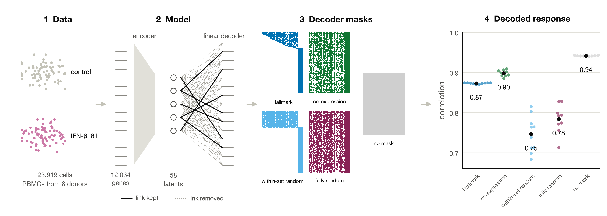
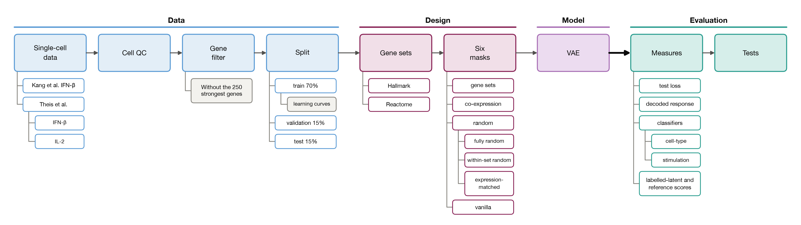
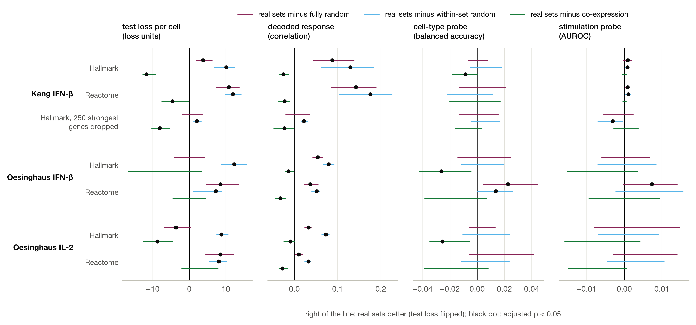
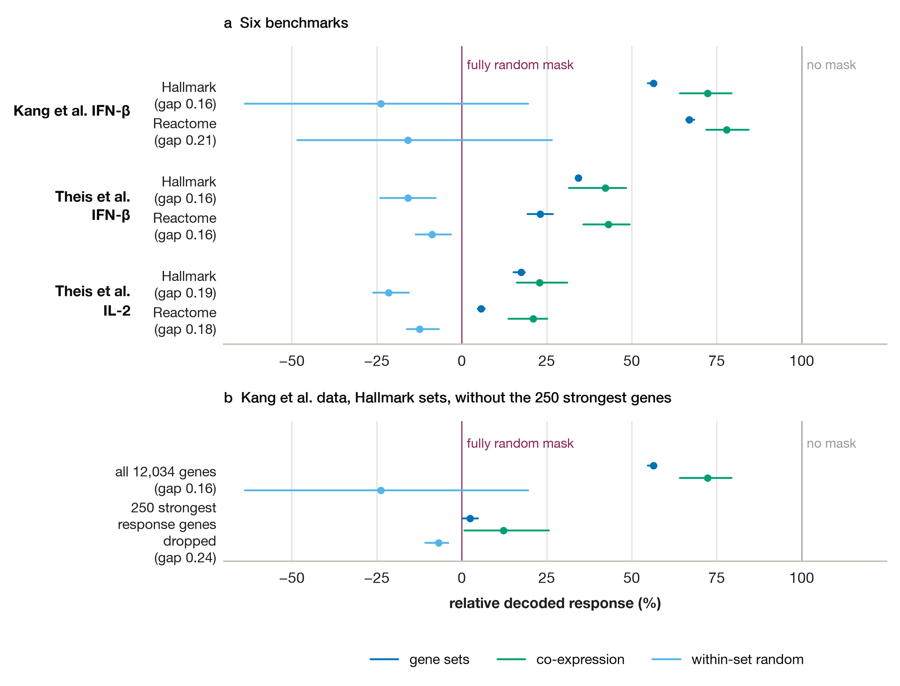

# Knowledge or sparsity? Gene set masks in a single-cell VAE



**Contents**

[Summary](#summary) · [Background](#background) · [Methods](#methods) · [Results](#results) · [Limitations](#limitations) · [Reproducing](#reproducing) · [Data and code availability](#data-and-code-availability) · [Future work](#future-work) · [Use of generative AI](#use-of-generative-ai) · [References](#references)

## Summary

**Key findings**

- Restricting the decoder to gene sets costs fit, and the gene set mask recovers part of that cost, mainly in the decoded stimulation response. Co-expressed groups found in the data do as well, so the results do not separate curated biology from grouping the responding genes.
- **Sparsity has a cost.** The no-mask VAE has the lowest test loss in all six benchmarks. Its encoder width was chosen on it, so part of the gap may reflect tuning.
- **The gene set mask reproduces the response better than random masks of the same sparsity** in all six benchmarks (adjusted p = 0.023, the smallest possible with 10 seeds and 12 tests). The advantage is smaller on the Theis et al. data and smallest for IL-2.
- **The test-loss gain is small and less consistent.** It is 4 to 10 units in the Kang et al. data, against a cost of 31 to 52. It holds against the fully random mask in four of six benchmarks.
- **Co-expressed groups do as well or better** in all six benchmarks. Only gene sets give each latent a biological name chosen before training.
- **The advantage rests largely on the strongest response genes.** Without the 250 strongest genes it vanishes against the fully random mask. Against the within-set random mask it falls to a fifth. On the 90% of genes with the smaller shifts the noise ceiling is 0.38.
- **No data-efficiency benefit over the unmasked VAE, at the encoder width chosen on it.** Its decoded response is above that of the Hallmark mask at every training size from 500 to 16,749 cells. The Hallmark mask is above the fully random mask at every size.

**At a glance**

- **Question:** in a single-cell RNA-seq variational autoencoder (VAE) restricted to gene sets, does the knowledge in the sets or the sparsity they impose explain how well it captures a known response? Six follow-up questions vary the comparison mask, the number of training cells, the genes, the collection, the data set and the stimulus ([Research questions](#research-questions)).
- **Data:** stimulated against control blood cells (PBMCs) in three contrasts. Interferon-β in 8 lupus patients for 6 h (Kang et al.; 23,919 cells, 12,034 genes). Interferon-β and interleukin-2 in 12 healthy donors for 24 h (Theis et al., a preprint; 28,800 cells and about 11,340 genes each).
- **Response:** the shift in gene expression that the stimulus causes between control and stimulated cells, which the decoder should reproduce.
- **Model:** a VAE whose linear decoder is restricted by a binary mask, in five variants. These are no mask, gene sets, two random masks of the same sparsity, and groups of co-expressed genes found in the data. The gene sets are the Hallmark collection (50 sets refined for coherent expression) or 50 Reactome sets chosen from size, overlap and pathway hierarchy, never from expression.
- **Benchmarks:** the five variants fit with 10 seeds on six benchmarks, two collections on each of three contrasts ([Study design](#study-design)).
- **Evaluation:** four measures that choose no latent: test loss, decoded stimulation shift, cell-type probe and stimulation probe. The score of the latent named after the known answer, learning curves and a repeat without the 250 strongest stimulation genes are in the [supplementary results](docs/supplementary.md).
- **Limitations:** the stimulation probe on the Kang et al. data is at its ceiling (area under the ROC curve, AUROC, 0.998 to 0.999 for every variant). Each condition of the Kang et al. data was sequenced in one run, so a run effect cannot be separated from the stimulation. The two Theis et al. contrasts share their donors, and the Reactome sets are one draw.

## Background

Knowledge-guided single-cell models build biological knowledge into a model so that its output can be read in
biological terms. Prior knowledge can enter a model in three ways [2]:

- as input features, such as gene set or transcription-factor activity scores;
- in the architecture, as sparse or masked layers that mirror gene sets;
- as a graph of gene interactions.

This project tests the architecture route. Each latent variable (a hidden factor that the model infers for every cell)
is tied to a gene set: a masked linear decoder lets latent k reach only the genes of set k, so its value in a cell reads
as the activity of that gene set. Such models are interpretable by design, and they are expected to need fewer cells
because they need not re-discover patterns that are already well known.

Several published models are built this way, and others use gene sets in related ways.

| Model | Kind |
|---|---|
| VEGA [3], expiMap [4] | single-cell VAE with a masked decoder |
| pmVAE [5] | single-cell VAE with one sub-network per pathway |
| f-scLVM [6], PLIER [7], Spectra [8] | factor model |
| KPNN [9] | supervised neural network |
| MOFA-FLEX [10] | factor model |
| Moullet et al. [11] | self-supervised model |

Across 29 pathway-informed neural networks trained for prediction, randomized models that kept the sparsity and architecture
of each evaluable original consistently matched or outperformed it [1]. VEGA [3] and expiMap [4], which both evaluate on
interferon-β-stimulated PBMCs, report masked decoders. Neither reports a random gene set control in its main text or Methods. The closest control, in
MOFA-FLEX [10], swaps 30% of the genes of each set with random non-members and tests whether the original programs are
recovered. It is not known whether the knowledge in the gene sets helps in unsupervised single-cell models, or only the
sparsity that the mask imposes. Earlier work leaves the questions below open, and each shapes the design.

### Research questions

Each question below follows from a gap in earlier work and from the design choice that gap forces. Q1 is the core question. Each follow-up changes one thing about Q1 and keeps the contrast, the measures and the correction (gene set mask minus random mask on four measures that choose no latent).

- **Q1: knowledge or sparsity?** A gene set mask fixes 89% of the decoder weights at zero. Any gain over a model without a mask could
  come from the sparsity alone. A random mask keeps the size and overlaps of every set and changes only its
  biology. It isolates the effect of the knowledge. Two versions are used (Study design).
- **Q1a: pre-specified sets or co-expressed genes found in the data?** A curated panel of 17 signatures, and most Hallmark sets, align with the main axes of expression more than
  size-matched random sets do in bulk tumour data [12] (a preprint), and the Hallmark sets were refined for coherent expression [20]. A
  Hallmark mask could beat a random one only because its genes are co-expressed. Groups of co-expressed genes of the same
  sizes, found in this data set, test whether pre-specified sets add anything beyond that.
- **Q1b: less data needed?** expiMap was reported to learn more sample-efficiently than the linear-decoder VAE LDVAE [13] with fewer training samples [4]. The report has no random gene set control in its main text or Methods. Learning curves test this ([supplementary S3](docs/supplementary.md)).
- **Q1c: does the advantage rest on the strongest response genes?** If the Hallmark advantage over random masks came only from those genes, it would say little about gene sets in general. Dropping the 250 genes with the strongest stimulation effect from the data, rebuilding every mask on the rest and repeating the comparison tests this ([supplementary S4](docs/supplementary.md)).
- **Q1d: does it hold with a second collection?** The Hallmark sets were refined from expression data. Reactome [26] is curated pathway by pathway and was not built from expression, so repeating the comparison with Reactome sets tests whether the result depends on the kind of knowledge ([supplementary S5](docs/supplementary.md)).
- **Q1e: does it hold in a second data set?** The Kang et al. data are one experiment. The stimulation is confounded with the sequencing run, and the stimulation probe is saturated. The same stimulus in other donors, with every donor's stimulated and control cells on one plate, tests whether the result is specific to that data set ([supplementary S5](docs/supplementary.md)).
- **Q1f: does it hold with a second stimulus?** An interferon is the response that both collections name most directly. A cytokine that is not an interferon tests whether the result is specific to interferon ([supplementary S5](docs/supplementary.md)).

The questions, the one change each makes to Q1 and the supplement that extends each are summarised below.

| Label | Question | Change from Q1 | Supplement |
| --- | --- | --- | --- |
| Q1 | Does the knowledge in the gene sets, or only the sparsity they impose, explain how well the model captures the response? | none: Kang et al. data, Hallmark, gene set mask against random masks | S1, S2 |
| Q1a | Do pre-specified sets add anything beyond groups of co-expressed genes found in the data? | the comparison mask | S1 |
| Q1b | Does knowledge make learning more data-efficient? | training size, interferon-α score and decoded response | S3 |
| Q1c | Does the advantage rest on the strongest response genes? | the 250 strongest stimulation genes dropped | S4 |
| Q1d | Does it hold with a second collection of gene sets? | Reactome instead of Hallmark | S5 |
| Q1e | Does it hold in a second data set? | Theis et al. interferon-β instead of the Kang et al. data | S5 |
| Q1f | Does it hold with a second stimulus? | Theis et al. IL-2 instead of interferon-β | S5 |

The six benchmarks are crossed. Q1d compares the Hallmark and Reactome rows within a contrast, and Q1e compares the Kang et al. data with the Theis et al. data for interferon-β. Q1f compares interferon-β with IL-2 in the Theis et al. data.

## Methods

Detailed methods, including the equations, the architecture summary and the scoring code, are in [docs/methods.md](docs/methods.md).

### Study design

Five variants share one architecture and one training setup and differ only in the decoder mask (overview, panel 3). Each is fit with 10 seeds on six benchmarks. Baselines and structure-preserving controls are included because randomized pathways and simple baselines can match more elaborate models [1, 15, 16].

| Variant | Decoder mask | Tests |
|---|---|---|
| No mask (vanilla VAE, LDVAE [13]) | none | reference without knowledge |
| Gene set mask | the 50 sets of the collection (Hallmark or Reactome) | knowledge + sparsity |
| Fully random | the gene sets with the labels of all genes randomly permuted | sparsity alone; free latents can reach set genes |
| Within-set random | the gene sets with the labels of set genes randomly permuted among set genes | sparsity alone; free latents reach the same genes as in the gene set mask |
| Co-expression | groups of co-expressed genes found in this data, same sizes | data-derived structure (an alternative mask) |

The six benchmarks cross three contrasts with two collections of gene sets. The table lists the data set, donors, cells, genes and stimulus of each contrast, then the collection and the known-answer set of each benchmark.

<table>
<thead><tr><th>Data</th><th>Donors</th><th>Cells</th><th>Genes</th><th>Stimulus</th><th>Collection</th><th>Known-answer set</th></tr></thead>
<tbody>
<tr><td rowspan="2">Kang et al. [17]</td><td rowspan="2">8 (lupus)</td><td rowspan="2">23,919</td><td rowspan="2">12,034</td><td rowspan="2">IFN-β, 6 h</td><td>Hallmark (main)</td><td>interferon-α response</td></tr>
<tr><td>Reactome</td><td>interferon α/β signaling</td></tr>
<tr><td rowspan="4">Theis et al. [41]</td><td rowspan="4">12 (healthy)</td><td rowspan="4">28,800</td><td rowspan="2">11,340</td><td rowspan="2">IFN-β, 24 h</td><td>Hallmark</td><td>interferon-α response</td></tr>
<tr><td>Reactome</td><td>interferon α/β signaling</td></tr>
<tr><td rowspan="2">11,344</td><td rowspan="2">IL-2, 24 h</td><td>Hallmark</td><td>IL-2 STAT5 signaling</td></tr>
<tr><td>Reactome</td><td>interleukin-2 family signaling</td></tr>
</tbody>
</table>

Each collection row is one benchmark, so the table lists six.

Two analyses are added on the main benchmark: learning curves (Q1b) and a repeat without the 250 strongest stimulation genes (Q1c). Figure 1 shows the pipeline of every benchmark. Each benchmark has its own Holm family. The collections and data sets are reported side by side without a ranking. The three contrasts are not independent replications (the Theis et al. contrasts share donors and one experiment), Reactome is one draw of sets, and no donor is held out.

**Two random masks.** In the Hallmark mask 8,847 genes (74%) belong to no set, and only the 8 free latents reach them (Reactome: 8,947, 74%). A random mask must decide what to do with those genes, and the choice changes what the comparison measures.

- **Fully random** shuffles all 12,034 genes, so set genes and genes in no set trade places. In the Hallmark mask 43 to 59 of the 95 interferon-α genes fall among the genes in no set. No named latent can reach them there, so the Hallmark−random difference partly measures where the interferon genes lie, in a set or in no set. This was the random control fixed before the runs.
- **Within-set random** shuffles only the 3,187 set genes (Hallmark) among themselves. The genes in no set, and so the genes the free latents reach, are identical to the gene set mask, and every interferon-α gene stays reachable by a named latent. It isolates the value of knowing which genes belong together. It was added after a review of the first results.

Both are reported; the within-set random mask is the stricter control.



**Figure 1. Pipeline.** Each box is a step of the analysis, and the small boxes under it list what varies. The grey boxes are the two analyses added on the main experiment. The pipeline runs for each of the six benchmarks.

### Data

The data are from Kang et al. [17] (GEO GSE96583, batch 2). PBMCs from 8 patients with systemic lupus erythematosus
(SLE; GEO lists "subject status: SLE patient" for both samples; called donors below) were cultured for 6 h without (ctrl)
or with interferon-β (stim), and each condition was pooled and sequenced in one 10x run. Every donor appears in both
conditions. The authors' genotype-based singlet calls (demuxlet) and cell-type labels are used as given.

Cells were filtered for quality (QC) by removing those beyond 5 median absolute deviations in log total counts, log detected genes or share of counts in the top 20 genes. This is a median-absolute-deviation filter of the kind recommended in [18]; the threshold of 5, set per condition × cell type, is this study's choice, and it was computed with scanpy [19]. This reduced 24,673 labelled singlets to 23,919 cells (3.1% removed; 0.8–5.0% per cell type, 20.8% of megakaryocytes). Genes detected in at least 20 cells were kept and all of them are modelled, which leaves 12,034 genes. Cells are split within every donor × condition × cell type group into 70% training, 15% validation and 15% test.

Three preprocessing choices were made for this data set.

- **QC thresholds per cell type.** Thresholds per condition alone removed 5–7% of CD14+ monocytes, 9–18% of dendritic cells and 20–27% of
  megakaryocytes but under 2% of lymphocytes. The RNA profiles of these cell types differ from those of lymphocytes.
- **All genes instead of highly variable genes.** Selecting 5,000 highly variable genes drops interferon-induced genes
  such as PSMB9 and B2M and a third of the Hallmark interferon-α set.
- **No ambient-RNA correction or mitochondrial filter.** The data set has no empty droplets to estimate ambient RNA from, and mitochondrial genes have
  no counts in the count matrices.

#### Theis et al. data

The second data set is the Human Cytokine Dictionary of Theis et al. [41] (a preprint, not peer reviewed), distributed by Parse Biosciences as "10 Million Human PBMCs in a Single Experiment" [42]: 12 healthy donors, 90 cytokines and an unstimulated control, 24 h. The licence is CC BY-NC 4.0, so the repository downloads the data and does not redistribute them. One cytokine is contrasted with the control, with every donor in both conditions.

Each donor was cultured on one 96-well plate, with the cytokines and the control on that plate [42]. Stimulated and control cells of a donor therefore share a plate, and the stimulation is not confounded with a plate or sequencing run, unlike in the Kang et al. data. Position on the plate can still matter: the published table of differentially expressed genes flags well-biased rows, which were excluded when the cytokine was chosen. The same donors serve every cytokine, so the cytokines are not independent replications of each other.

- **Cytokines.** Interferon-β, as a replication of the stimulation in the Kang et al. data, and one cytokine that is not an interferon. Its choice was fixed from the published differential-expression table alone, before any model was fitted. Among TNF-α, IL-6 and IL-2, the three that have a Reactome set among the 50, it is the one with the most differentially expressed genes summed over cell types (adjusted p < 0.05, |log fold change| ≥ 0.5, well-biased rows excluded). IL-2 had 25,835, IL-6 1,521 and TNF-α 1,419 (interferon-β 31,780).
- **Cells.** The 41 GB file is read in place from the published archive (only the chosen runs of cells are transferred, about 1 GB). Cells are read until each donor × condition group has 1,800. QC as for the Kang et al. data (5 median absolute deviations per cell type and condition) removes 0.9% for IL-2, and at most 1,200 cells per group are kept, which gives 28,800 cells for each cytokine.
- **Genes.** The 11,344 of the 12,031 genes of the Kang et al. data that are detected in at least 20 cells of the contrast (11,340 for interferon-β). The masks and the weight match of the Reactome draw therefore keep their design.
- **Split and scored cell types.** 70/15/15 within every donor × condition × cell type group. A cell type is scored when the test split has at least 20 cells of both conditions: 13 of 18 types (HSPC, ILC, NKT, plasmablasts and pDC are not).

### Gene sets and masks

The Hallmark mask uses the Hallmark collection [20] from the Molecular Signatures Database (MSigDB) v2024.1. It has 50 sets of at least 12 genes (median
117.5) and no near-duplicate sets: the largest overlap, between the early and late estrogen responses, is a Jaccard
index of 0.34. Its one unambiguous target for this data is the interferon-α response, with 95 of its 97 genes present.
The Hallmark sets were built from many founder sets by automated overlap analysis and expert curation, so that each conveys one
biological state or process with coherent expression, and they were made as inputs for gene set enrichment analysis [20].
They therefore draw on expression data, as the groups of co-expressed genes do.
Gene symbols are matched through Ensembl IDs to current symbols of the HUGO Gene Nomenclature Committee (HGNC) [21].

Two random masks (negative controls) replace the Hallmark sets with sets of the same sizes, and a third mask replaces them with groups of
co-expressed genes found in the data. Each is built 10 times, and the run with seed k uses version k.

- **Fully random mask** (`04_build_masks.py`). Genes are put into 25 bins of equal size (481–482 genes) by their mean
  count in training cells. Gene labels are then permuted within each bin: each gene takes over the set memberships
  of another gene from its bin. Every set keeps its size, its overlaps with other sets and its expression level. Only
  its biology changes. A full shuffle changes 98% of set members; the rest are reassigned to a member of their own set. Genes in no set are shuffled too.
- **Within-set random mask** (`04_build_masks.py`). The same bins, but only genes that are in at least one set are
  permuted, and only among themselves. Genes in no set stay in no set. Every set keeps its size and its overlaps; 95% of set members change.
- **Co-expression mask** (`05_build_coexpression_null.py`). This mask tests whether pre-specified sets add anything beyond
  co-expressed genes found in this data set. It is a data-derived alternative to the Hallmark mask. It is built from the training cells alone, without condition or cell-type labels. For each seed,
  50 seed genes are drawn at random from the 6,753 genes detected in ≥ 1% of training cells. Group j is seed gene j plus
  the n − 1 genes most positively correlated with it (Pearson correlation of log-transformed, depth-scaled counts), where
  n is the size of Hallmark set j (12–197 genes). A group keeps the size of the Hallmark set it replaces and none of its biology; groups are
  built independently and may share genes. Three properties affect how the results are read.

  - **Coherence.** The median within-set correlation is 0.096 for the groups and 0.003 for Hallmark sets, so the groups are a demanding
    comparison for the Hallmark sets.
  - **Overlap.** The groups cover 2,338–3,233 genes (Hallmark: 3,187). Ribosomal-protein genes and PTMA are in up to 28
    groups per seed; no Hallmark gene is in more than 10 sets.
  - **Interferon.** In every seed, the group most raised by IFN-β is enriched for Hallmark interferon genes (19–89% of
    its genes, against a base rate of 1.8%). The data alone recover the core interferon response.

  The full recipe is in [docs/methods.md](docs/methods.md#co-expression-mask-full-recipe).

### Reactome sets

The comparison is repeated with Reactome [26] in place of Hallmark (`SC_SETS=reactome`), using the 1,736 sets of the MSigDB v2024.1 collection C2 CP:REACTOME. Reactome is curated pathway by pathway and was not built from expression data, so it tests the same question with knowledge of another kind. The 50 sets are chosen from names, sizes, overlaps and Reactome's pathway hierarchy only, never from expression or stimulation.

- **Known answers.** Five Reactome sets take the slots of the five Hallmark sets that are the known answers of a stimulus (interferon-α, interferon-γ, TNF-α, IL-6, IL-2). They are interferon alpha/beta signaling, interferon gamma signaling, TNF signaling, interleukin-6 family signaling and interleukin-2 family signaling. They are narrower than the Hallmark sets (62, 80, 52, 14 and 36 genes against 95, 192, 188, 74 and 167).
- **Other 45 slots.** Each slot takes a Reactome set of the size of its Hallmark set (within 10%), drawn at random from the sets that
  - overlap every set chosen so far by a Jaccard index below 0.34, the largest overlap between two Hallmark sets;
  - have at least 50% of their genes among the 12,034 QC genes (the 10th percentile of the Hallmark sets, which have 0.30 to 0.98);
  - are not under the Disease branch of Reactome's pathway hierarchy, as Hallmark has no disease or pathogen sets (the 39 sets that cannot be matched to a Reactome pathway by name are excluded only when their name contains SARS, DEFECT, INFECTION, HIV, DISEASE, CANCER or MUTANT);
  - carry none of INTERFERON, IFN, IRF, TNF, IL-6 or IL-2 in the name, as Hallmark has no second set for those stimuli.
- **Sparsity.** Selection seeds 0, 1, 2 and so on were tried in order. The first draw with as many trainable decoder weights as the Hallmark mask (within 1%) was kept. Seed 2 gave 76,579 against 76,344 (5,003 memberships and 3,087 genes in sets, against 5,568 and 3,187; median set size 99 against 117.5; largest overlap 0.33).
- **Controls.** The fully random mask, the within-set random mask and the co-expression groups are built from the Reactome sets by the recipes above. The interferon α/β set is the target latent.
- **Draw.** The draw includes developmental and tissue-specific sets that PBMCs express, as Hallmark does. The Reactome hierarchy file is Reactome's release of 20 October 2026, which differs from the release behind MSigDB v2024.1.

The Reactome and Hallmark comparisons are tested separately, each with the four latent-free measures and its own Holm family of 12 tests.

### Model

Every variant uses the same VAE [37]. The numbers below are for the Kang et al. data, with the Hallmark sets unless stated. The encoder (one hidden layer of 128 units, ReLU, dropout 0.1) reads the 12,034 genes after a shifted-log transform, plus a one-hot code for the 8 donors. It proposes a mean and a variance for each of the 58 latents (50 named, 8 free). The decoder is linear. Each latent raises or lowers the genes that the mask lets it reach, and the donor adds an offset. A softmax over genes gives each gene's share of the counts of the cell. The observed counts follow a negative binomial with a dispersion per gene. The loss is the negative log-likelihood plus the Kullback–Leibler (KL) divergence of the posterior from a standard normal prior. The equations and symbols are in [docs/methods.md](docs/methods.md#model-equations), the architecture summary and parameter counts below them.

The mask decides how many of the 697,972 weights in `w` can be trained in the Kang et al. data.

| Variant | Hallmark | Reactome |
|---|---|---|
| No mask | 697,972 | 697,972 |
| Gene set mask | 76,344 (5,568 set memberships + 8 free latents × 8,847 genes in no set) | 76,579 (5,003 + 8 × 8,947) |
| Fully random | 76,344 (same sizes and overlaps as the gene set mask) | 76,579 |
| Within-set random | 76,344 (same sizes and overlaps as the gene set mask) | 76,579 |
| Co-expression | 75,976–83,136 (by seed) | 77,251–83,827 |

The Theis et al. data have 11,340 or 11,344 genes and 12 donors, so 657,720 or 657,952 weights, of which 70,956 to 71,155 can be trained in the gene set masks.

Four design choices concern the decoder and its inputs.

- **Linear decoder in every variant.** Each latent has one weight for each gene. The mask is the only
  architectural difference between variants.
- **Named and free latents.** In the masked variants, latents 1–50 may only use the genes of their set. The 8 free
  latents may only use the genes in no set (8,847, or 74%, in the Hallmark and random masks) or, in the co-expression mask, in no group. Free latents that could reach all genes absorbed the
  stimulation signal and the named latents became inactive, so they are kept off the set genes. This choice followed pilot runs.
- **Donor, not condition.** Donor is a covariate in encoder and decoder. The stimulation is the signal the latents should find, so
  condition is never a covariate.
- **Likelihood.** Negative binomial on raw counts. The library size is the observed total count, and the
  model has no zero inflation [22].

All variants are trained with the same settings.

| Setting | Value |
|---|---|
| Optimiser | Adam [38] |
| Learning rate | 1e-3 |
| Batch size | 128 |
| KL warm-up | $\beta$ rises linearly from 0 to 1 over 10,000 steps at batch 64, counted in cells seen: ≈ 38 epochs at every training size (`--warmup-epochs`) |
| Stopping | early stopping on validation loss with a patience of 3 epochs [14], counted after the KL warm-up; any decrease counts as an improvement (`--min-delta 0`); at most 2,000 epochs (`--max-epochs`) |
| Encoder width | 128, chosen on the no-mask VAE |
| Seeds | 10 per variant; each seed sets the initial weights, the batches and (for the random and co-expression masks) the mask. The train/validation/test split is fixed (seed 0) |
| Validation loss | computed with the same latent draws at every epoch. Early stopping then follows the model and not the sampling noise |
| Software | versions under Reproducing; the last digits of the losses differ between CPU and GPU |

### Evaluation

Four measures choose no latent. They are computed for every run on the test cells; validation cells only fit the probes. Megakaryocytes are mostly platelets, which have no nucleus, and are excluded from all scores and kept in training. The interferon-α latent score, the reference scores without a VAE and the learning curves are described in the [supplementary results](docs/supplementary.md).

| Asks | Measure | Computation |
|---|---|---|
| How well does the model reconstruct cells it was not trained on? | Test loss | Negative log-likelihood per test cell plus the KL term at weight 1 (natural logarithm, so in nats), the training objective; lower is better |
| Does the decoder reproduce the stimulation effect? | Decoded response | The decoder gives the expected share of every gene for a test cell from its latent means and donor. For each cell type on the test set, the mean decoded log expression (the encoder's shifted-log scale) of stimulated minus control cells is correlated across the 6,753 genes detected in ≥ 1% of training cells with the observed shift, and averaged over the scored cell types (7 for the Kang et al. data, 13 for the Theis et al. data). Labels define only the observed shift. A second value uses the 95 interferon-α genes alone |
| Do the latents represent cell type, which the model never saw? | Cell-type probe | Multinomial logistic regression on standardised latent means, fitted on validation cells, balanced accuracy on test cells. Descriptive variants: 10, 50 and 200 validation cells per type, and the AUROC between CD4 and CD8 T cells and between CD14+ and FCGR3A+ monocytes |
| Does the representation reflect the stimulation response? | Stimulation probe | Logistic regression on all 58 latents fitted on validation cells; AUROC [28] per cell type on test cells |

**Known answer in the Theis et al. data.** The latent-free measures do not use a known answer. The score of the named latent does. For interferon-β it is the Hallmark interferon-α response set or the Reactome interferon-α/β set. For IL-2 it is the Hallmark IL-2 STAT5 signaling set or the Reactome interleukin-2 family signaling set. The named latent is oriented without labels, by the sign of its mean weight on its own genes.

#### Statistics

- **Tests.** Each variant has 10 seeds, paired by seed. The replicate is the training run. The split, the donors and the cells are fixed, so the tests concern variation in training and in the random masks. Every test is an exact two-sided Wilcoxon signed-rank test [35] of the paired differences (the smallest possible p with 10 pairs is 0.002). It is reported with the median of the paired differences and an exact distribution-free interval from the same test. The median is not moved by a single extreme seed, as the mean would be, and the random masks produce such seeds. Strictly, it is the Hodges–Lehmann estimate [36], the median of the averages of every pair of the 10 differences. The 12 tests of the four measures above (gene set mask minus the three other masks) form one family per benchmark (family `latent-free` in `tests.csv`; it answers Q1, Q1a and, for each benchmark, Q1c to Q1f), corrected with Holm [30] (family-wise error 0.05), with intervals at the Bonferroni level [31]. The four tests of the response-matched control (Hallmark minus the response-matched mask on the same four measures) form a separate family per benchmark (family `responsematch` in `tests.csv`), also corrected with Holm (supplementary S4). Holm has no matching interval, so the intervals are widened to the Bonferroni level, which keeps their simultaneous coverage at 95% and makes them slightly wider than the tests imply. `reports/tables/kang/hallmark/tests.csv` (`src/11_tests.py`) lists every test, and only adjusted p-values are quoted. The families of the supplementary results are described there. The 18 learning-curve tests are many and correlated, so their false discovery rate is controlled at 0.05 with the Benjamini–Hochberg procedure [32] (supplementary S3).
- **Symmetry check.** The signed-rank interval assumes paired differences that are symmetric about the median. An exact sign-test interval of at least the same level, which does not, gives the same decision (interval excludes zero or not) for 80 of the 84 latent-free contrasts (7 benchmarks × 12); it is not adjusted for multiplicity. In the other four the sign-test interval reaches zero, while the signed-rank interval and the adjusted p exclude it. These are test loss against co-expression (Kang et al. data, Reactome), the stimulation probe against the within-set random mask (Kang et al. data, Hallmark, without the 250 strongest genes), the decoded response against co-expression (Theis et al. interferon-β, Hallmark) and the cell-type probe against the within-set random mask (Theis et al. interferon-β, Reactome). In the 24 tests of the response-matched control the two intervals agree in 23; the exception is the stimulation probe in the Kang et al. data with Reactome sets. Of the 28 contrasts of supplementary S1 and S3 on the main benchmark, one differs (best latent of the within-set random mask minus that of the no-mask VAE).
- **Order of decisions.** The interferon-α latent and its score (supplementary S1) and the Hallmark-versus-random comparison were fixed before the 10-seed runs. Four decisions came after looking at results: the restriction of the free latents to genes in no set (made after pilot runs), the within-set random mask, the latent-free measures and the grouping of tests into families. Dropping the 250 strongest genes was a later analysis. Its criterion (Hallmark against the random masks for test loss and decoded response) was fixed before its 10-seed run, following a 2-seed pilot. The Reactome sets, the rule that chose IL-2 and the scored cell types of the Theis et al. data were fixed before any model was fitted on them (Q1d to Q1f). The alternative decoded-response measures, the noise ceiling, the decoded response on the learning curves and the sign-test intervals were added after the main results; they are descriptive and add no adjusted test. Per-cell-type and per-donor scores are descriptive.

## Results

The results follow the labels of [Research questions](#research-questions). The main experiment answers Q1 and Q1a, two analyses on it answer Q1b and Q1c, and the six benchmarks answer Q1d to Q1f. Figure 2 compares the gene sets with the other masks in test loss and decoded response in every benchmark.



**Figure 2. Gene sets against the other masks in test loss and decoded response, six benchmarks.** Each line is the interval of the paired difference over 10 seeds (gene sets minus the other mask, at the Bonferroni level), so a line right of zero means the gene sets are better. Test loss is flipped. Each line is drawn in the colour of the mask it is compared with, and a black dot at the median marks an adjusted p below 0.05. The dot is open when the interval reaches zero. The cell-type and stimulation probes are in Supplementary Figure 12.

### Q1 and Q1a: sparsity costs fit, and the gene sets recover part of it

Benchmark: Kang et al. data, Hallmark. All 50 runs (5 variants × 10 seeds) stopped early. Values are mean ± SD over 10 seeds. The overview (panel 4) shows the decoded response of every seed, and the first row of Figure 2 shows the paired differences in test loss and decoded response.

| Measure | No mask | Hallmark | Fully random | Within-set random | Co-expression |
|---|---|---|---|---|---|
| Test loss per cell | 1929.1 ± 1.0 | 1971.4 ± 1.2 | 1975.3 ± 1.5 | 1981.3 ± 1.4 | 1959.9 ± 1.5 |
| Decoded response, all genes | 0.942 ± 0.001 | 0.873 ± 0.001 | 0.784 ± 0.034 | 0.746 ± 0.044 | 0.898 ± 0.008 |
| Decoded response, interferon-α genes | 0.985 ± 0.001 | 0.972 ± 0.002 | 0.801 ± 0.075 | 0.734 ± 0.110 | 0.974 ± 0.007 |
| Cell-type balanced accuracy | 0.885 ± 0.006 | 0.855 ± 0.004 | 0.855 ± 0.005 | 0.850 ± 0.010 | 0.864 ± 0.008 |
| Stimulation probe AUROC | 0.9989 ± 0.0003 | 0.9988 ± 0.0002 | 0.9979 ± 0.0007 | 0.9980 ± 0.0003 | 0.9988 ± 0.0002 |


Hallmark minus each other mask over 10 seeds. The first two columns answer Q1 (random masks, same sparsity), the third Q1a (co-expressed groups). Each cell gives the median difference, the Holm-adjusted p [30] (12 tests) and the interval at the Bonferroni level.

| Measure | Hallmark − fully random (Q1) | Hallmark − within-set random (Q1) | Hallmark − co-expression (Q1a) |
|---|---|---|---|
| Test loss per cell (lower is better) | −3.7<br>p = 0.023<br>[−6.3, −2.0] | −10.1<br>p = 0.023<br>[−12.4, −6.9] | +11.8<br>p = 0.023<br>[+9.2, +12.7] |
| Decoded response (correlation) | +0.087<br>p = 0.023<br>[+0.045, +0.138] | +0.129<br>p = 0.023<br>[+0.062, +0.183] | −0.026<br>p = 0.023<br>[−0.035, −0.014] |
| Cell-type balanced accuracy | +0.001<br>p = 1.000<br>[−0.006, +0.008] | +0.006<br>p = 0.697<br>[−0.005, +0.018] | −0.009<br>p = 0.029†<br>[−0.018, +0.000] |
| Stimulation probe (AUROC) | +0.0009<br>p = 0.039†<br>[−0.0002, +0.0019] | +0.0008<br>p = 0.023<br>[+0.0004, +0.0013] | +0.0001<br>p = 1.000<br>[−0.0004, +0.0005] |

The value 0.023 is the smallest possible with 10 seeds and 12 tests (an exact p of 0.002 times 12): all 10 seeds differ in the same direction.

† Adjusted p below 0.05 with an interval that reaches or includes zero. The Holm test rejects at a looser threshold than the Bonferroni-level interval.

**Q1: knowledge or sparsity?** Sparsity costs fit, and the gene sets recover part of that cost.

- **Sparsity has a cost.** Against the no-mask VAE, the masked variants lose 31 to 52 units of loss per cell. They also lose 0.04 to 0.20 of decoded-response correlation and 0.02 to 0.04 of cell-type balanced accuracy. The no-mask VAE leads on all three. Its encoder width was chosen on it, so part of this gap may reflect the tuning; the comparisons among the masked variants are not affected.
- **The gene sets recover part of the cost.** The Hallmark mask has a lower test loss than the random masks, by 3.7 and 10.1 units. These are about 8% and 20% of the loss penalty of the random masks, each the median paired difference over the median paired difference between the random mask and the no-mask VAE. It also reproduces the stimulation shift better, with a correlation of 0.873 against 0.784 and 0.746 (about 55% and 64% of the gap between the random masks and the no-mask VAE, by the same definition). On the interferon-α genes alone the Hallmark decoder reaches 0.972, the random masks 0.801 and 0.734. The latent named after the interferon-α set carries the response, where the random masks' latent at that position does so unreliably (supplementary S1).
- **Knowledge does not change the cell-type representation.** Hallmark and random masks do not differ (adjusted p 1.0 and 0.70). Few-shot probes and the two hard pairs show the same picture (supplementary S2).
- **The stimulation probe is saturated.** All variants score 0.998 to 0.999. The Hallmark mask exceeds the random masks by under 0.001, a difference that is detectable but of no practical size. Without any VAE, the best principal component scores 0.997 and the mean of the interferon-α genes 0.996 (supplementary S1).

**Q1a: pre-specified sets or co-expressed genes?** Co-expressed genes do at least as well. The co-expression mask fits better (11.8 units), reproduces the shift better (0.898) and separates cell types slightly better (+0.009). On the interferon-α genes the two masks are nearly equal. The interferon-α latent of the Hallmark mask is equivalent to the best latent of the co-expression mask within ±0.005 AUROC (supplementary S1). The groups are built from the training cells, and this favours them on fit. Only the Hallmark sets give each latent a biological name chosen before training, such as "interferon-α response"; the meaning of a group has to be worked out after training.

### Q1b: the unmasked VAE leads at every training size

The interferon-α score is saturated. With 500 training cells the no-mask VAE already scores 0.992 and the Hallmark mask 0.996, and Hallmark and co-expression do not differ at any size (supplementary S3). The decoded response is not. With it the no-mask VAE is above the Hallmark mask at every size, by 0.07 to 0.09 from 500 to 16,749 cells, so the prior knowledge brings no sample efficiency over the unmasked linear VAE at the encoder width chosen on it. The Hallmark mask is above the fully random mask at every size, by 0.12 at 500 cells and 0.09 at full size, and the trend of that difference with size is negative in 8 of 10 seeds. These differences carry no test (supplementary S3).

### Q1c: the advantage rests largely on the strongest response genes



**Figure 3. Decoded response relative to the fully random mask.** Each variant is placed between a fully random mask (0) and no mask (100); the dot is the mean of 10 seeds and the line the range. The fully random mask is the zero reference, so its own spread is not shown. The gap under each row label is the decoded response of the no-mask VAE minus that of the fully random mask, the denominator of the scale. (a) The six benchmarks. (b) The main experiment with and without the 250 strongest response genes. The absolute values are in supplementary S4 and S5.

The Hallmark advantage rests largely on the strongest response genes. With the 250 strongest stimulation genes dropped, Hallmark no longer differs from the fully random mask in test loss or decoded response (adjusted p 1.0). Its advantage over the within-set random mask falls to about one fifth (test loss −2.1 units, decoded response +0.022; adjusted p 0.023; Figure 3b and supplementary S4).

A random mask that keeps the strong response genes among its set genes does not recover the advantage. This response-matched mask permutes the labels among the set genes only, inside bins of expression level and stimulation effect, so every set keeps the number of genes of each response strength (supplementary S4). Against it the Hallmark mask has a lower test loss (by 6.8 to 13.1 units) and a higher decoded response (by 0.019 to 0.130) in all six benchmarks, in every one of the 10 seeds (adjusted p 0.008). The decoded response of the response-matched mask is within 0.009 of that of the fully random mask in five benchmarks and 0.034 above it in the Kang et al. data with Hallmark sets. The cell-type and stimulation probes differ little: four of the 12 tests are significant, three in favour of the Hallmark mask.

Noise sets a ceiling on the decoded response. The highest correlation a noise-free model could reach with the observed shift (the square root of the split-half correlation of the test cells, corrected to full size) is 0.96 with all genes in the Kang et al. data and 0.84 without the 250 strongest genes. On the 90% of genes with the smaller shifts it is 0.38, so those genes cannot separate the masks. The no-mask VAE reaches 0.94 of 0.96 with all genes and 0.77 of 0.84 without the 250 strongest, so the ceiling does not explain the loss of the advantage. The mean of the gene set mask is above both random masks on the rank correlation and on the correlation weighted by the size of the observed shift in all seven benchmarks (the six and the repeat without the 250 strongest genes; supplementary S4). In the Kang et al. data the advantage over the fully random mask is 0.108 on the 250 strongest genes (0.926 against 0.818) and 0.030 on all other genes (0.574 against 0.544); these are differences of means over 10 seeds, without a test.

### Q1d to Q1f: the response advantage recurs, the test-loss advantage does not always

The comparison of Q1 was repeated with Reactome sets on the Kang et al. data, and with both collections on interferon-β and IL-2 of the Theis et al. data. Each benchmark has 10 seeds and the five variants. Each benchmark has its own Holm family of 12 tests; an asterisk marks an adjusted p below 0.05. Figure 3a shows the decoded response and Figure 2 the paired differences with their intervals, and the tables of test loss and decoded response are in [supplementary S5](docs/supplementary.md#s5-reactome-and-the-oesinghaus-data-q1d-q1e-q1f). Q1d is read by rows (Hallmark against Reactome within a contrast), Q1e by contrast (the Kang et al. data against Theis et al., interferon-β) and Q1f by contrast (interferon-β against IL-2, Theis et al. data).

Across the six benchmarks the gene set mask reproduces the stimulation shift better than both random masks and worse than the co-expression mask. The adjusted p is 0.023 against the random masks and 0.023 to 0.041 against the co-expression mask. It fits better than the within-set random mask in every benchmark. The other results depend on the question.

#### Q1d: the response result holds in both collections, the test-loss result does not

- **Decoded response.** The ordering of Q1 holds with Reactome as with Hallmark. The advantage over the fully random mask is larger for Reactome in the Kang et al. data (+0.142 against +0.087) and smaller on both Theis et al. contrasts (+0.037 against +0.054, and +0.010 against +0.033).
- **Test loss.** The Reactome mask beats the fully random mask in all three contrasts, by 8.5 to 10.8 units. The Hallmark mask does so only in the Kang et al. data. The co-expression mask fits better than the Hallmark mask in every benchmark (by 9 to 12 units; not significant for interferon-β). It fits about as well as the Reactome mask on the Theis et al. data.
- **Reading.** The decoded-response result does not depend on the collection, and the test-loss result does. The collections are two draws of 50 sets with different known-answer sets (narrower in Reactome), so the rows are not a ranking of the collections.

#### Q1e: the response advantage is smaller in the second data set

- **Decoded response.** For interferon-β the gene set mask is above both random masks in both data sets. The advantage is smaller in the Theis et al. data (over the fully random mask +0.054 and +0.037 against +0.087 and +0.142).
- **Test loss.** The Hallmark mask loses its advantage over the fully random mask (−3.7 in the Kang et al. data, +0.8 in the Theis et al. data). The Reactome mask keeps it (−10.8 and −8.5), and both beat the within-set random mask in both data sets.
- **Probes.** The stimulation probe is not saturated in the Theis et al. data (0.89 to 0.95). Only Reactome on interferon-β separates the gene set mask from the fully random one on it (+0.0073). It is also the only collection for which the cell-type probe differs between the gene set mask and the random masks. The difference from the within-set random mask is borderline, because its sign-test interval reaches zero.
- **Named latent.** The interferon-α/β latent of the gene set mask carries the interferon-β response in the Theis et al. data (AUROC 0.87 to 0.89). In the Kang et al. data it scores 0.997 for Hallmark, where every variant is near the ceiling.

#### Q1f: the advantage is smaller for IL-2 than for interferon-β

- **Decoded response.** The advantage over the fully random mask is smaller for IL-2 than for interferon-β in the same data (+0.033 against +0.054 for Hallmark, +0.010 against +0.037 for Reactome). The value +0.010 is the smallest of the six.
- **Test loss.** Hallmark is worse than the fully random mask for IL-2 (+3.7) where it is no different for interferon-β. Reactome is better by 8.5 units for both.
- **Named latent.** The latent named after IL-2 does not follow the stimulation (AUROC 0.44 for Hallmark, 0.50 for Reactome). A free latent of the same model does (0.80 to 0.83). The sets most raised in the IL-2 contrast are the interferon sets. The IL-2 benchmark therefore tests the IL-2 set alone. It is neither a second interferon replication nor a clean test of a non-interferon stimulus (supplementary S5).

## Limitations

- **Scope (Q1 to Q1c).** The main analysis uses one data set, one stimulus and one target. The cells are PBMCs from 8 donors (patients with SLE, whose type I interferon activity is often raised at baseline [29]) stimulated with IFN-β. The target with a known answer is the Hallmark interferon-α response. The interferon-α and -γ sets share 71 of 95 genes, so the target is not specific to type I interferon. The Theis et al. data add two stimulations from the same 12 donors and one experiment, so these are not independent replications. The IL-2 contrast is dominated by an interferon response, so its known answer is not specific either.
- **Saturation.** The stimulation is so strong that a principal component, the mean of the interferon-α genes and every variant separate the conditions (stimulation probe 0.998 to 0.999, best principal component 0.997, mean of the interferon-α genes 0.996; supplementary S1). The stimulation probe therefore cannot rank the variants, and the learning curves of the interferon-α score cannot show a data-efficiency effect (Q1b, supplementary S3).
- **Stimulation and run are confounded.** Each condition was pooled and sequenced in one 10x run, without ambient-RNA correction, so every stimulation score includes any run effect. Removing the strongest stimulation genes removes the separation. This argues against a diffuse shift, but run effects among those genes cannot be excluded. An independent data set with replicate runs would settle it.
- **Source of the gain over random masks (Q1c).** The better fit and decoded response of the Hallmark mask may come mainly from sets that respond to the stimulation, such as interferon, TNF-α and inflammatory response. Dropping the strongest genes (supplementary S4) shows that the advantage over the fully random mask depends on the strongest response genes. Whether the remaining advantage over the within-set random mask comes from other responsive sets was not separated. A data set without such sets could behave differently.
- **Hallmark sets and co-expressed groups.** The Hallmark sets were refined for coherent expression and made for enrichment analysis [20], so they are not independent of expression data. The groups of co-expressed genes are built from the training cells, and this favours them on fit. Q1a compares sets named in advance with sets found in this data. Reactome, built by manual pathway curation and not from expression, adds a collection that is independent of expression data (Q1d). It is compared with co-expressed groups built from the same data, which favour fit in the same way.
- **One Reactome draw (Q1d).** The Reactome comparison uses one draw of 50 sets from about 950 eligible, so a difference between the two collections refers to this draw and not to Reactome as a whole. The 10 seeds do not measure the draw. The known-answer sets of Reactome are narrower than those of Hallmark, so a smaller Reactome advantage can reflect narrower sets.
- **Seeds.** The 10 seeds vary the training and one draw of each random mask. The split, the donors (8 for the Kang et al. data, 12 for the Theis et al. data) and the cells are fixed. The test cells share their donors with the training cells and no donor was held out, so the intervals say nothing about new donors. The SD of the random masks (0.034 and 0.044 for the decoded response) mixes the draw of the mask with the training noise.
- **Design.** Hard mask and linear decoder only; soft masks, nonlinear decoders, gene set scores as input features and graph models were not tested. The 8 free latents reach only genes in no set, because with access to all genes they absorbed the response and the named latents became inactive. This choice shapes the result. Learning rate (1e-3), encoder width (128, chosen on the no-mask VAE) and patience (3 epochs) are shared by all variants and were not tuned for each. Because the encoder width was chosen on the no-mask VAE, its lead over the masked variants may be overstated.
- **Theis et al. subsample (Q1e, Q1f).** About 28,800 cells of each contrast are used (at most 1,200 per donor × condition group after QC). Five cell types with too few test cells are not scored.
- **Preprocessing.** The 2017 gene annotation (hg19), the cell-type labels and the demuxlet calls come from the authors of the data. Doublets of two cells from the same donor are not detected (an estimated 2% of cells), and ambient RNA is not corrected.

## Reproducing

The scripts are numbered in run order and run from the repository root in a fresh virtual environment. All results were produced on an Apple M1 Pro (16 GB) under macOS 15.7 with PyTorch [39], scikit-learn [40], scanpy [19], AnnData [43], NumPy [44], pandas [45], SciPy [46] and Matplotlib [47]; `requirements.txt` sets minimum versions only. Exact versions:

```
python 3.13.15   torch 2.14.1 (Apple GPU through MPS)   scanpy 1.12.4   anndata 0.13.4
numpy 2.5.3   pandas 3.0.6   scipy 1.18.1   scikit-learn 1.9.1
matplotlib 3.11.2   scikit-misc 0.5.2   tqdm 4.70.1
```

```
python3 -m venv .venv
source .venv/bin/activate
pip install -r requirements.txt
python src/01_download_kang.py
python src/02_download_genesets.py
python src/03_preprocess_kang.py
python src/04_build_masks.py
python src/05_build_coexpression_null.py
bash src/07_experiment.sh
python src/08_evaluate.py
```

The options of `06_fit.py`, the learning curves, checks, tests and figures, and the commands for the other benchmarks (Reactome, the 250 strongest genes dropped, the Theis et al. data) are in [docs/reproducing.md](docs/reproducing.md).

| Path | Contents |
|---|---|
| `src/` | numbered scripts in run order, with the shared set-up in `scoring.py`; `06_fit.py` trains one model per call and is run by `07_experiment.sh` |
| `src/gene_sets.py` | the data set (`SC_DATA`), gene set collection (`SC_SETS`), benchmark (`SC_TAG`) and known answer (`SC_TARGET`) a script works on |
| `src/extras/learning_curves/` | training subsamples and the runs on them (supplementary S3) |
| `src/extras/hvg_inspection.py` | highly-variable-gene analysis behind the choice to model all genes |
| `data/`, `results/` | created by the scripts, not tracked; `results/<data>/<collection>/<variant>/seed<k>/`, for example `results/kang/hallmark/real/seed0/` |
| `reports/tables/<data>/<collection>/` | the main experiment is `kang/hallmark`; scores per run, AUROCs per cell type, paired differences, every hypothesis test (`tests.csv`), robustness checks (`robustness_*.csv`) and diagnostics (`diagnostics_*.csv`) |
| `reports/tables/*/*/tests.csv`, column `family` | `S1` (interferon-α latent, supplementary S1), `S3` (learning curves, Q1b) and `latent-free` (Q1, Q1a and Q1c to Q1f: one table per benchmark) |
| Questions and tables | Q1, Q1a, Q1b: `kang/hallmark`; Q1c: `kang_drop250/hallmark`; Q1d to Q1f: the six benchmarks `kang/{hallmark,reactome}`, `oesinghaus_ifn_beta/{hallmark,reactome}`, `oesinghaus_il_2/{hallmark,reactome}` |
| `reports/figures/` | figures |
| `docs/reproducing.md` | options of `06_fit.py`, commands for the learning curves, checks, tests, figures and the other benchmarks |
| `docs/methods.md` | co-expression recipe, model equations, architecture summary, scoring code, biological choices by pipeline step, data sets used and for future work |

## Data and code availability

**Data.** All data are public. The Kang et al. data [17] (8 donors, interferon-β) are in the Gene Expression Omnibus under GSE96583 (batch 2). The Theis et al. data [41] are the Parse Biosciences data set "10 Million Human PBMCs in a Single Experiment" [42], released under CC BY-NC 4.0. The scripts read that archive in place and do not redistribute it. The gene sets are the Hallmark collection [20] and the Reactome collection (C2 CP:REACTOME) of the Molecular Signatures Database v2024.1. The Reactome pathway hierarchy [26] is the release of 20 October 2026, and gene symbols follow the HGNC [21].

**Results.** The tables behind every figure, test and number in this report (scores per run, paired differences and tests for each benchmark) are in the repository. Trained model outputs are recreated by the scripts and are not stored.

**Code.** The code is at https://github.com/gmiliarakis/knowledge-or-sparsity-sc-vae under the MIT licence.

## Future work

The same comparison could be repeated on harder questions and other data. Data sets are listed in
[docs/methods.md](docs/methods.md#data-sets-used-and-for-future-work).

- **Known regulators.** Do the explanations recover known regulators? B cell differentiation with IRF4 and PRDM1 perturbations offers such ground truth [23].
- **Protein as reference.** Does RNA-based pathway activity agree with CITE-seq surface protein, an independent
  measurement?
- **Imperfect gene sets.** What is the cost of incomplete or species-transferred gene sets, for example human sets
  applied to mouse gastrulation data [25]? And does a soft mask started from random sets refine to the same
  gene sets?
- **Held-out donors and further Reactome draws.** Holding out donors of the Theis et al. data would test the result on unseen donors. Further draws of Reactome sets would measure the variation that one draw hides (Limitations).

## Use of generative AI

The author used Claude Opus 5.5 and Claude Sonnet 5.5 (Anthropic) between September and October 2026 to help write and debug analysis code and to improve the readability of the text. The author designed the study, ran all analyses, and wrote the text. The author reviewed all AI-assisted code and text and takes full responsibility for the accuracy, integrity and originality of this work.

## References
1. Caranzano I, et al. Sparsity is all you need: rethinking biologically informed neural networks. *Brief Bioinform*
   (2026). [doi:10.1093/bib/bbag425](https://doi.org/10.1093/bib/bbag425)
2. Thapa K, et al. Strategies to include prior knowledge in omics analysis with deep neural networks. *Patterns*
   6, 101203 (2025). [doi:10.1016/j.patter.2025.101203](https://doi.org/10.1016/j.patter.2025.101203)
3. Seninge L, et al. VEGA is an interpretable generative model for inferring biological network activity in
   single-cell transcriptomics. *Nat Commun* (2021).
   [doi:10.1038/s41467-021-26017-0](https://doi.org/10.1038/s41467-021-26017-0)
4. Lotfollahi M, et al. Biologically informed deep learning to query gene programs in single-cell atlases.
   *Nat Cell Biol* (2023). [doi:10.1038/s41556-022-01072-x](https://doi.org/10.1038/s41556-022-01072-x)
5. Gut G, et al. pmVAE: learning interpretable single-cell representations with pathway modules. *bioRxiv* (2021).
   [doi:10.1101/2021.01.28.428664](https://doi.org/10.1101/2021.01.28.428664)
6. Buettner F, et al. f-scLVM: scalable and versatile factor analysis for single-cell RNA-seq. *Genome Biol* (2017).
   [doi:10.1186/s13059-017-1334-8](https://doi.org/10.1186/s13059-017-1334-8)
7. Mao W, et al. Pathway-level information extractor (PLIER) for gene expression data. *Nat Methods* (2019).
   [doi:10.1038/s41592-019-0456-1](https://doi.org/10.1038/s41592-019-0456-1)
8. Kunes RZ, et al. Supervised discovery of interpretable gene programs from single-cell data. *Nat Biotechnol*
   (2024). [doi:10.1038/s41587-023-01940-3](https://doi.org/10.1038/s41587-023-01940-3)
9. Fortelny N, Bock C. Knowledge-primed neural networks enable biologically interpretable deep learning on
   single-cell sequencing data. *Genome Biol* (2020).
   [doi:10.1186/s13059-020-02100-5](https://doi.org/10.1186/s13059-020-02100-5)
10. Qoku A, et al. MOFA-FLEX: a factor model framework for integrating omics data with prior knowledge. *bioRxiv*
    (2025). [doi:10.1101/2025.11.03.686250](https://doi.org/10.1101/2025.11.03.686250)
11. Moullet M, et al. Self-supervised learning for a gene program-centric view of cell states. *bioRxiv* (2026).
    [doi:10.64898/2026.03.24.713961](https://doi.org/10.64898/2026.03.24.713961)
12. Zhu Y, et al. A residual-ratio framework for auditing transcriptomic gene signatures against background
    expression structure. *bioRxiv* (2026). [doi:10.64898/2026.04.11.717907](https://doi.org/10.64898/2026.04.11.717907)
13. Svensson V, et al. Interpretable factor models of single-cell RNA-seq via variational autoencoders.
    *Bioinformatics* (2020). [doi:10.1093/bioinformatics/btaa169](https://doi.org/10.1093/bioinformatics/btaa169)
14. Eltager M, et al. Benchmarking variational autoencoders on cancer transcriptomics data. *PLoS One* (2023).
    [doi:10.1371/journal.pone.0292126](https://doi.org/10.1371/journal.pone.0292126)
15. Makrodimitris S, et al. An in-depth comparison of linear and non-linear joint embedding methods for bulk and
    single-cell multi-omics. *Brief Bioinform* (2024). [doi:10.1093/bib/bbad416](https://doi.org/10.1093/bib/bbad416)
16. Ahlmann-Eltze C, et al. Deep-learning-based gene perturbation effect prediction does not yet outperform simple
    linear baselines. *Nat Methods* (2025). [doi:10.1038/s41592-025-02772-6](https://doi.org/10.1038/s41592-025-02772-6)
17. Kang HM, et al. Multiplexed droplet single-cell RNA-sequencing using natural genetic variation. *Nat Biotechnol*
    (2018). [doi:10.1038/nbt.4042](https://doi.org/10.1038/nbt.4042)
18. Heumos L, et al. Best practices for single-cell analysis across modalities. *Nat Rev Genet* (2023).
    [doi:10.1038/s41576-023-00586-w](https://doi.org/10.1038/s41576-023-00586-w)
19. Wolf FA, et al. SCANPY: large-scale single-cell gene expression data analysis. *Genome Biol* (2018).
    [doi:10.1186/s13059-017-1382-0](https://doi.org/10.1186/s13059-017-1382-0)
20. Liberzon A, et al. The Molecular Signatures Database (MSigDB) hallmark gene set collection. *Cell Syst* (2015).
    [doi:10.1016/j.cels.2015.12.004](https://doi.org/10.1016/j.cels.2015.12.004)
21. Seal RL, et al. Genenames.org: the HGNC resources in 2023. *Nucleic Acids Res* (2023).
    [doi:10.1093/nar/gkac888](https://doi.org/10.1093/nar/gkac888)
22. Svensson V. Droplet scRNA-seq is not zero-inflated. *Nat Biotechnol* (2020).
    [doi:10.1038/s41587-019-0379-5](https://doi.org/10.1038/s41587-019-0379-5)
23. Demela P, et al. Competing gene regulatory networks drive naive and memory B cell differentiation. *Mol Syst Biol*
    (2026). [doi:10.1038/s44320-026-00207-8](https://doi.org/10.1038/s44320-026-00207-8)
24. Massoni-Badosa R, et al. An atlas of cells in the human tonsil. *Immunity* (2024).
    [doi:10.1016/j.immuni.2024.01.006](https://doi.org/10.1016/j.immuni.2024.01.006)
25. Pijuan-Sala B, et al. A single-cell molecular map of mouse gastrulation and early organogenesis. *Nature* (2019).
    [doi:10.1038/s41586-019-0933-9](https://doi.org/10.1038/s41586-019-0933-9)
26. Milacic M, et al. The Reactome Pathway Knowledgebase 2024. *Nucleic Acids Res* (2024).
    [doi:10.1093/nar/gkad1025](https://doi.org/10.1093/nar/gkad1025)
27. Waddell SJ, et al. Dissecting interferon-induced transcriptional programs in human peripheral blood cells.
    *PLoS One* (2010). [doi:10.1371/journal.pone.0009753](https://doi.org/10.1371/journal.pone.0009753)
28. Hanley JA, McNeil BJ. The meaning and use of the area under a receiver operating characteristic (ROC) curve.
    *Radiology* (1982). [doi:10.1148/radiology.143.1.7063747](https://doi.org/10.1148/radiology.143.1.7063747)
29. Sim TM, et al. Type I interferons in systemic lupus erythematosus: a journey from bench to bedside. *Int J Mol Sci*
    (2022). [doi:10.3390/ijms23052505](https://doi.org/10.3390/ijms23052505)
30. Holm S. A simple sequentially rejective multiple test procedure. *Scand J Stat* 6, 65–70 (1979).
    [jstor.org/stable/4615733](https://www.jstor.org/stable/4615733)
31. Dunn OJ. Multiple comparisons among means. *J Am Stat Assoc* 56, 52–64 (1961).
    [doi:10.1080/01621459.1961.10482090](https://doi.org/10.1080/01621459.1961.10482090)
32. Benjamini Y, Hochberg Y. Controlling the false discovery rate: a practical and powerful approach to multiple
    testing. *J R Stat Soc B* 57, 289–300 (1995).
    [doi:10.1111/j.2517-6161.1995.tb02031.x](https://doi.org/10.1111/j.2517-6161.1995.tb02031.x)
33. Benjamini Y, Yekutieli D. The control of the false discovery rate in multiple testing under dependency. *Ann Stat*
    29, 1165–1188 (2001). [doi:10.1214/aos/1013699998](https://doi.org/10.1214/aos/1013699998)
34. Benjamini Y, Yekutieli D. False discovery rate-adjusted multiple confidence intervals for selected parameters.
    *J Am Stat Assoc* 100, 71–81 (2005). [doi:10.1198/016214504000001907](https://doi.org/10.1198/016214504000001907)
35. Wilcoxon F. Individual comparisons by ranking methods. *Biometrics Bull* 1, 80–83 (1945).
    [doi:10.2307/3001968](https://doi.org/10.2307/3001968)
36. Hodges JL, Lehmann EL. Estimates of location based on rank tests. *Ann Math Stat* 34, 598–611 (1963).
    [doi:10.1214/aoms/1177704172](https://doi.org/10.1214/aoms/1177704172)
37. Kingma DP, Welling M. Auto-encoding variational Bayes. *arXiv* (2013), presented at ICLR 2014.
    [doi:10.48550/arXiv.1312.6114](https://doi.org/10.48550/arXiv.1312.6114)
38. Kingma DP, Ba J. Adam: a method for stochastic optimization. *arXiv* (2014), presented at ICLR 2015.
    [doi:10.48550/arXiv.1412.6980](https://doi.org/10.48550/arXiv.1412.6980)
39. Paszke A, et al. PyTorch: an imperative style, high-performance deep learning library. *arXiv* (2019), presented
    at NeurIPS 2019. [doi:10.48550/arXiv.1912.01703](https://doi.org/10.48550/arXiv.1912.01703)
40. Pedregosa F, et al. Scikit-learn: machine learning in Python. *J Mach Learn Res* 12, 2825–2830 (2011).
    [jmlr.org/papers/v12/pedregosa11a.html](https://jmlr.org/papers/v12/pedregosa11a.html)
41. Theis F, et al. A single-cell cytokine dictionary of human peripheral blood. *Research Square* (2025), preprint, not peer reviewed. [doi:10.21203/rs.3.rs-8337240/v1](https://doi.org/10.21203/rs.3.rs-8337240/v1)
42. Parse Biosciences. 10 Million Human PBMCs in a Single Experiment (data set, CC BY-NC 4.0). https://www.parsebiosciences.com/datasets/10-million-human-pbmcs-in-a-single-experiment/ (accessed 21 October 2026).
43. Virshup I, et al. anndata: access and store annotated data matrices. *J Open Source Softw* (2024). [doi:10.21105/joss.04371](https://doi.org/10.21105/joss.04371)
44. Harris CR, et al. Array programming with NumPy. *Nature* (2020). [doi:10.1038/s41586-020-2649-2](https://doi.org/10.1038/s41586-020-2649-2)
45. McKinney W. Data structures for statistical computing in Python. *Proc 9th Python in Science Conf* (2010). [doi:10.25080/Majora-92bf1922-00a](https://doi.org/10.25080/Majora-92bf1922-00a)
46. Virtanen P, et al. SciPy 1.0: fundamental algorithms for scientific computing in Python. *Nat Methods* (2020). [doi:10.1038/s41592-019-0686-2](https://doi.org/10.1038/s41592-019-0686-2)
47. Hunter JD. Matplotlib: a 2D graphics environment. *Comput Sci Eng* (2007). [doi:10.1109/MCSE.2007.55](https://doi.org/10.1109/MCSE.2007.55)
