# Supplementary results

Results that extend the main report ([README](../README.md)). Each part is labelled with the question it serves (README, [Research questions](../README.md#research-questions)). Statistical tests are described there; all tests are in
`reports/tables/kang/hallmark/tests.csv` (for S4, `reports/tables/kang_drop250/hallmark/tests.csv`; for S5, `tests.csv` in `reports/tables/kang/reactome/` and `reports/tables/oesinghaus_*/*/`), and only adjusted p-values are quoted. The `family` column of `tests.csv` is `S1` (S1), `S3` (S3) or `latent-free` (the latent-free family of Q1, Q1a and Q1c to Q1f, one per benchmark).

## Statistics

The tests follow the procedure of the [README](../README.md#statistics). The correction is matched to each family. Holm [30] (family-wise error 0.05, intervals at the Bonferroni level [31]) controls the small families on which the conclusions rest. These are the 12 tests of S4 and the 10 tests on the interferon-α score at full size. Benjamini–Hochberg [32] (false discovery rate 0.05, valid for the positive dependence between sizes that share seeds [33], with false-coverage-rate intervals [34]) controls the 18 learning-curve tests. These are many and correlated. A single Holm family of all 52 tests is not possible, because with more than 25 tests it cannot reject at an exact p of 0.002 or larger. Equivalence of the Hallmark and co-expression masks on the interferon-α score is tested with two one-sided tests against ±0.005 AUROC (half a percentage point in the probability that a stimulated cell outranks a control cell). The margin was set before the within-set random mask was added. The 12 tests of S4 (Q1c) form their own family (Holm), and so do the 12 tests of each of the six benchmarks of S5 (Q1d to Q1f).

## S1. The interferon-α latent (Q1, Q1a)

The score of a latent named after the Hallmark interferon-α response set, and the reference scores without a VAE.

### Definition

A latent named after the Hallmark interferon-α response set should take higher values in stimulated cells. IFN-β is a type I interferon, and these genes are induced in blood cells [17, 20, 27]. The score is the AUROC [28] of the latent's posterior mean for stimulated against control cells, computed per cell type on the test set and averaged over the 7 types. A score of 0.5 is chance. For the Hallmark and both random masks the latent at the interferon-α position is scored, oriented without labels by the sign of its mean decoder weight. It scores 0.5 when inactive (variance of its posterior means over validation cells at most 0.01). The no-mask and co-expression variants have no names, so their active latent with the largest |AUROC − 0.5| on validation cells is scored on test cells (the best latent). This choice uses validation labels and favours these two variants.

The score shows where the response lies; it is not specific to interferon biology. Any latent whose genes respond to the stimulation can separate the conditions, the Hallmark interferon-α and -γ sets share 71 of 95 genes, and the score saturates near 1. Scoring code: `src/08_evaluate.py`, abridged in [methods.md](methods.md#scoring-code).

**Reference scores without a VAE:** the mean log expression of the interferon-α genes (no labels) and the best of 58 principal components of the training cells (chosen on validation labels), scored like the latents. The best principal component is also refitted after removing the 216 genes of the Hallmark interferon-α and -γ sets, or the 100 to 2,000 genes with the largest stimulation effect in training cells.

### Results

The interferon-α latent of the Hallmark mask scored 0.997 ± 0.001 (Supplementary Figure 1) and was its best latent in 9 of 10 seeds (the interferon-γ latent in the tenth). It scored higher than the latent at the same position of the random masks in all 10 seeds (adjusted p = 0.018 for both). Those latents scored 0.758 ± 0.218 and 0.815 ± 0.281.

The random masks carry the response in another latent (best latent 0.989 ± 0.005 and 0.994 ± 0.002; the interferon-α latent in 0 and 3 of 10 seeds). The score therefore does not identify a specific latent. A random set of about 100 genes scored 0.93 or higher in 6 of 10 within-set random seeds. Against co-expression the Hallmark latent is equivalent within ±0.005 (difference −0.0006, adjusted p = 0.010).

Every variant scores near the ceiling: without any VAE, the best principal component scores 0.997 and the mean of the interferon-α genes 0.996. After removing the 216 genes of the interferon-α and -γ sets the best component still scores 0.945. After removing the 500, 1,000 or 2,000 strongest stimulation genes it scores 0.744, 0.649 or 0.573. The separation rests on a few hundred genes. Because each condition was sequenced in its own 10x run, run effects among them cannot be excluded.

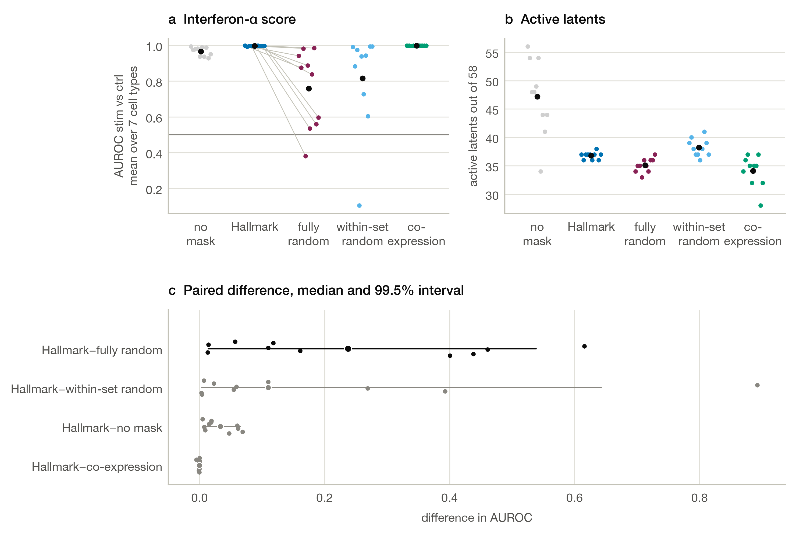

**Supplementary Figure 1. Interferon-α score of the Hallmark latent (Kang et al. data).** a, interferon-α score of every seed (lines join the Hallmark and random scores of the same seed). b, latents with an active posterior. c, paired difference of Hallmark minus each other variant, with the median and the Holm-adjusted interval; the primary comparison is in black.*

## S2. Cell-type probe, few-shot and hard pairs (Q1)

Balanced accuracy of the cell-type probe with 10, 50 and 200 validation cells per type, and the AUROC between CD4 and CD8 T cells and between
CD14+ and FCGR3A+ monocytes (mean ± SD over 10 seeds; the main report gives the probe on all validation cells). The probe is described under
Evaluation in the main report; types with fewer than k validation cells contribute all of them.

| Cell-type probe, descriptive | 10 per type | 50 per type | 200 per type | CD4 vs CD8 T cells | CD14+ vs FCGR3A+ monocytes |
|---|---|---|---|---|---|
| No mask | 0.815 ± 0.028 | 0.865 ± 0.008 | 0.884 ± 0.009 | 0.992 ± 0.001 | 0.962 ± 0.003 |
| Hallmark | 0.806 ± 0.023 | 0.839 ± 0.010 | 0.858 ± 0.003 | 0.984 ± 0.001 | 0.950 ± 0.004 |
| Fully random | 0.811 ± 0.026 | 0.840 ± 0.011 | 0.860 ± 0.008 | 0.986 ± 0.002 | 0.939 ± 0.005 |
| Within-set random | 0.805 ± 0.025 | 0.841 ± 0.012 | 0.857 ± 0.010 | 0.983 ± 0.003 | 0.949 ± 0.006 |
| Co-expression | 0.827 ± 0.017 | 0.854 ± 0.009 | 0.867 ± 0.009 | 0.991 ± 0.002 | 0.949 ± 0.009 |

## S3. Learning curves (Q1b)

### Design

The learning curves test whether Hallmark knowledge helps more when cells are scarce. The four variants other than the within-set random mask are refit on
smaller training sets and scored by the interferon-α latent score (S1).

- **Training sizes.** 500, 1,000, 2,000, 4,000, 8,000 and all ~16,700 training cells, as nested subsamples stratified
  by donor × condition × cell type. Each seed has its own series of subsamples, shared by these four variants. The
  comparison stays paired by seed, and the seeds also cover the choice of cells. Validation and test sets stay fixed,
  and the full-size point is the main experiment.
- **Training.** KL warm-up over ≈ 38 epochs, patience 3 epochs and learning rate 1e-3 at every size, with 10 seeds per
  variant and size.
- **Masks.** The groups of co-expressed genes and the expression bins of the fully random mask are rebuilt on each subsample. With few cells,
  correlations are noisier: the groups overlap less and cover ~4,100 genes at 500 cells.
- **Random masks.** Only the fully random mask was run on subsamples.

### Results

Interferon-α score, mean over 10 seeds at each training size.

| Training cells | No mask | Hallmark | Fully random | Co-expression | Hallmark − fully random |
|---|---|---|---|---|---|
| 500 | 0.992 | 0.996 | 0.482 | 0.993 | +0.514 |
| 1,000 | 0.987 | 0.997 | 0.636 | 0.996 | +0.362 |
| 2,000 | 0.982 | 0.997 | 0.610 | 0.997 | +0.387 |
| 4,000 | 0.975 | 0.997 | 0.672 | 0.997 | +0.325 |
| 8,000 | 0.972 | 0.997 | 0.552 | 0.997 | +0.445 |
| 16,749 | 0.966 | 0.997 | 0.758 | 0.998 | +0.239 |

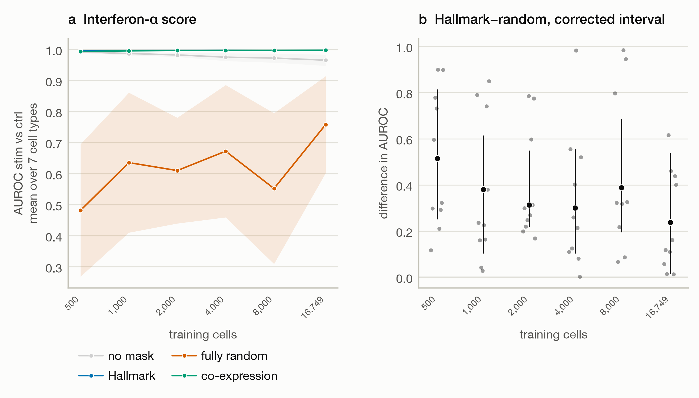

**Supplementary Figure 2. Learning curves (Kang et al. data, Hallmark).** (a) Mean over 10 seeds with a 95% t-interval band. (b) Per-seed Hallmark − fully random differences (dots), their median and the interval at the family level.*

- No data-efficiency benefit of Hallmark knowledge appeared, and this task cannot show one: with 500 cells the no-mask VAE already scores 0.992 and the Hallmark mask 0.996. Hallmark and co-expression do not differ at any size (adjusted p 0.089 to 1.0; Supplementary Figure 2).
- The Hallmark latent scores higher than the fully random mask's latent at every size (all 10 seeds, adjusted p = 0.003). This advantage is not shown to depend on training size (slope adjusted p = 0.14). The random mask's latent is unreliable at every size (single seeds 0.01 to 0.99).

### Decoded response on the learning curves

The interferon-α score saturates, so the learning curves are repeated with the decoded response (defined in the README, Evaluation), which does not. Same runs and sizes as above (Kang et al. data, Hallmark, 10 seeds; the within-set random mask was run at full size only, 0.746 ± 0.044). Mean ± SD over seeds.

| Training cells | No mask | Hallmark | Fully random | Co-expression |
|---|---|---|---|---|
| 500 | 0.821 ± 0.023 | 0.742 ± 0.016 | 0.620 ± 0.047 | 0.745 ± 0.028 |
| 1,000 | 0.880 ± 0.012 | 0.797 ± 0.009 | 0.656 ± 0.054 | 0.808 ± 0.033 |
| 2,000 | 0.911 ± 0.007 | 0.821 ± 0.007 | 0.695 ± 0.040 | 0.836 ± 0.025 |
| 4,000 | 0.926 ± 0.005 | 0.859 ± 0.009 | 0.780 ± 0.029 | 0.866 ± 0.012 |
| 8,000 | 0.938 ± 0.001 | 0.869 ± 0.002 | 0.759 ± 0.034 | 0.890 ± 0.007 |
| 16,749 | 0.942 ± 0.001 | 0.873 ± 0.001 | 0.784 ± 0.034 | 0.898 ± 0.008 |

Hallmark minus no mask: -0.079, -0.083, -0.090, -0.067, -0.069, -0.069 from 500 to 16,749 cells. Hallmark minus fully random: +0.122, +0.141, +0.127, +0.079, +0.110, +0.089. The Hallmark minus fully random difference has a negative slope against the logarithm of the training size in 8 of 10 seeds (mean −0.009 per doubling). These differences are descriptive and carry no test.

## S4. Dropping the 250 strongest stimulation genes (Q1c)

This analysis asks whether the Hallmark advantage over the random masks rests on the strongest stimulation genes. It drops them and repeats the comparison for test loss and decoded response. Dropping them also shrinks the Hallmark sets (32 of the 95 interferon-α genes remain), so the analysis also shows what happens when a gene set is incomplete.

### Design

The 250 genes with the largest |t| of stimulated against control log expression in training cells (megakaryocytes excluded) are dropped, leaving 11,784 genes (list in `reports/tables/kang_drop250/removed_genes_drop250.csv`). They are chosen from the data and never from the gene sets. The 50 Hallmark sets, both random masks and the groups of co-expressed genes are rebuilt on the remaining genes, and 3,032 genes are in at least one set. Architecture, training, scoring and the four measures are unchanged, with 10 seeds per variant. Seeds 0 and 1 were also run as a pilot before the decision to run all 10. The criterion was fixed before the 10-seed run: the sign and the Holm-adjusted p of the contrasts of Hallmark against the random masks for test loss and decoded response. Without any VAE, the best principal component scores 0.864 and the mean of the 32 remaining interferon-α genes 0.724.

### Results

| Variant | Test loss per cell | Decoded response | Cell-type balanced accuracy | Stimulation probe AUROC |
|---|---|---|---|---|
| No mask | 1718.2 ± 1.4 | 0.766 ± 0.002 | 0.881 ± 0.004 | 0.9877 ± 0.0009 |
| Hallmark | 1747.6 ± 0.7 | 0.528 ± 0.004 | 0.857 ± 0.007 | 0.9723 ± 0.0015 |
| Fully random | 1747.7 ± 2.0 | 0.522 ± 0.020 | 0.856 ± 0.006 | 0.9742 ± 0.0028 |
| Within-set random | 1749.7 ± 1.0 | 0.506 ± 0.005 | 0.850 ± 0.006 | 0.9756 ± 0.0014 |
| Co-expression | 1739.6 ± 1.6 | 0.552 ± 0.019 | 0.864 ± 0.005 | 0.9720 ± 0.0026 |

Hallmark minus each other mask over 10 seeds. Each cell gives the median difference, the Holm-adjusted p and the interval at the Bonferroni level.

| Measure | Hallmark − fully random | Hallmark − within-set random | Hallmark − co-expression |
|---|---|---|---|
| Test loss per cell (lower is better) | +0.3 p = 1.000 [−3.6, +2.0] | −2.1 p = 0.023 [−3.3, −1.2] | +8.1 p = 0.023 [+5.4, +10.3] |
| Decoded response (correlation) | +0.006 p = 1.000 [−0.020, +0.035] | +0.022 p = 0.023 [+0.016, +0.031] | −0.023 p = 0.023 [−0.048, −0.002] |

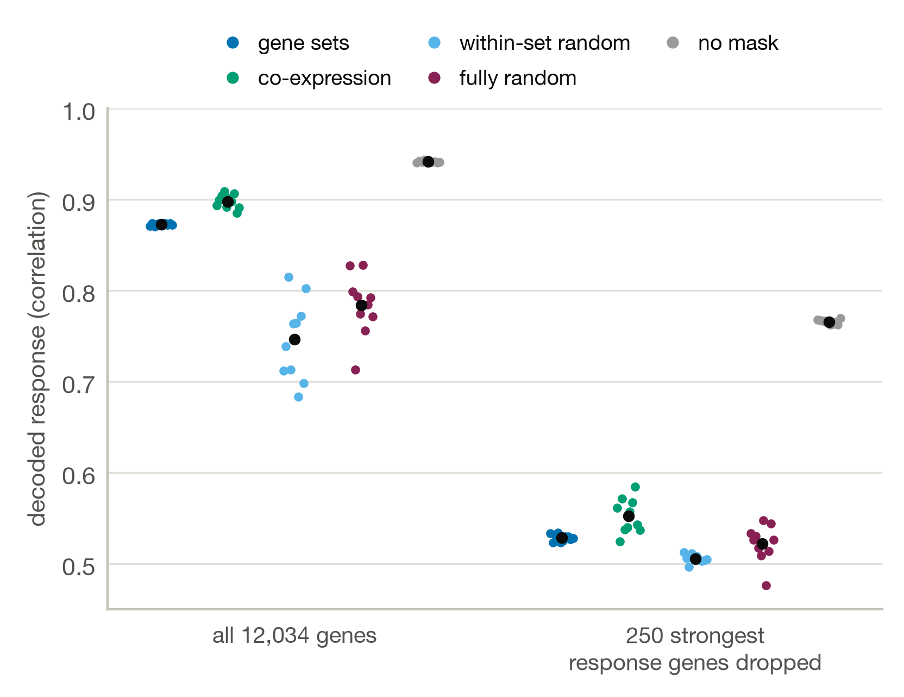

**Supplementary Figure 3. Decoded response of every variant with and without the 250 strongest genes (Kang et al. data, Hallmark).** Small points are seeds and the black point is the mean of 10 seeds.

Against the fully random mask the Hallmark advantage is gone (Supplementary Figure 3): the difference in test loss is +0.3 units and in decoded response +0.006. With all genes the differences are −3.7 and +0.087. Against the within-set random mask the advantage persists at about one fifth of its size (−2.1 units against −10.1, and +0.022 against +0.129). The groups of co-expressed genes still fit better than the Hallmark sets (8.1 units) and reproduce the shift better (0.023 higher).

The decoded response falls for every masked variant to 0.51 to 0.55, against 0.77 without a mask. The named interferon-α latent was inactive in all Hallmark and within-set random runs, and the best latent of the Hallmark and random masks scored 0.879 to 0.904 on average. Cell-type accuracy shows no difference (adjusted p of at least 0.26). The stimulation probe is lower for Hallmark than for the within-set random mask by 0.003 (adjusted p 0.031) and does not differ otherwise.

### Alternative measures and the noise ceiling

The decoded response is recomputed from the saved runs with five other measures, all across the genes detected in at least 1% of training cells and averaged over cell types: the rank correlation (Spearman), the correlation weighted by the absolute observed shift, the correlation on the 10% of genes with the largest observed shift in each cell type and on the other 90%, and, on the main benchmark, the correlation on the 250 strongest stimulation genes and on all other genes. The noise ceiling is the highest correlation a noise-free model could reach with the observed shift: the test cells of each cell type and condition are split into two random halves 50 times, the shifts of the halves are correlated across genes, the correlation is corrected to full size (2r/(1+r)), and the square root is taken. "None" marks a measure whose halves do not correlate. Means over 10 seeds.

**Kang et al. data, Hallmark (all 12,034 genes)**

| Variant | Pearson (README) | Spearman | Pearson weighted | Strongest 10% of genes | Other 90% of genes | 250 strongest genes | All other genes |
|---|---|---|---|---|---|---|---|
| No mask | 0.942 | 0.555 | 0.987 | 0.965 | 0.482 | 0.980 | 0.784 |
| Hallmark | 0.873 | 0.426 | 0.959 | 0.899 | 0.337 | 0.926 | 0.574 |
| Co-expression | 0.898 | 0.461 | 0.973 | 0.924 | 0.355 | 0.953 | 0.612 |
| Within-set random | 0.746 | 0.404 | 0.816 | 0.780 | 0.307 | 0.786 | 0.506 |
| Fully random | 0.784 | 0.412 | 0.852 | 0.813 | 0.319 | 0.818 | 0.544 |
| Noise ceiling | 0.96 | 0.71 | 0.99 | 0.98 | 0.38 | 0.99 | 0.85 |

**Kang et al. data, Hallmark, without the 250 strongest genes**

| Variant | Pearson (README) | Spearman | Pearson weighted | Strongest 10% of genes | Other 90% of genes |
|---|---|---|---|---|---|
| No mask | 0.766 | 0.490 | 0.897 | 0.859 | 0.412 |
| Hallmark | 0.528 | 0.342 | 0.656 | 0.620 | 0.279 |
| Co-expression | 0.552 | 0.381 | 0.687 | 0.646 | 0.308 |
| Within-set random | 0.506 | 0.332 | 0.624 | 0.590 | 0.282 |
| Fully random | 0.522 | 0.336 | 0.647 | 0.604 | 0.280 |
| Noise ceiling | 0.84 | 0.65 | 0.95 | 0.93 | none |

On every measure the Hallmark mask is above both random masks in the main benchmark, and in all benchmarks (the six and the repeat without the 250 strongest genes) on the rank and the weighted correlation. Without the 250 strongest genes the no-mask VAE (0.766) is below its ceiling (0.84) by 0.07, so the ceiling does not explain the loss of the advantage over the fully random mask. On the 90% of genes with the smaller shifts the ceiling is 0.38 on the main benchmark and the shifts of the halves do not correlate on the others, so those genes cannot separate the masks.

### Response-matched random mask

The Hallmark advantage over random masks could come from the sets containing the strongest response genes. The response-matched mask tests this. It permutes the labels among the set genes only, inside bins of expression level and stimulation effect, so every set keeps the number of genes of each response strength. It was fit with 10 seeds on the six benchmarks. The four measures that choose no latent form their own family of four tests per benchmark, corrected with Holm and separate from the 12 tests of the main family.

**Hallmark minus the response-matched mask.** Median of the paired differences over 10 seeds; an asterisk marks a Holm-adjusted p below 0.05 within the four tests of each benchmark. Test loss is lower for the better mask.

| Data | Collection | Test loss per cell | Decoded response | Cell-type balanced accuracy | Stimulation probe AUROC |
|---|---|---|---|---|---|
| Kang et al. IFN-β | Hallmark | −7.1* | +0.048* | +0.002 | +0.0003 |
| Kang et al. IFN-β | Reactome | −13.1* | +0.130* | −0.006* | +0.0009* |
| Theis et al. IFN-β | Hallmark | −8.8* | +0.047* | −0.001 | −0.0001 |
| Theis et al. IFN-β | Reactome | −7.0* | +0.036* | +0.012* | +0.0067* |
| Theis et al. IL-2 | Hallmark | −7.7* | +0.042* | +0.004 | +0.0002 |
| Theis et al. IL-2 | Reactome | −6.8* | +0.019* | +0.008 | +0.0018 |

The Hallmark mask has a lower test loss and a higher decoded response than the response-matched mask in all six benchmarks, in every seed (adjusted p 0.008). The decoded response of the response-matched mask is within 0.009 of that of the fully random mask in five benchmarks, and 0.034 above it in the Kang et al. data with Hallmark sets. The cell-type and stimulation probes differ little: four of the 12 tests are significant, three of them in favour of the Hallmark mask.

## S5. Reactome and the Theis et al. data (Q1d, Q1e, Q1f)

This analysis asks whether the comparison of the main report holds with a second collection of gene sets (Q1d), a second data set (Q1e) and a second stimulus (Q1f). The reasons for each addition are in the [README](../README.md#background); this section reports the results.

### Design

The six benchmarks, the data and the known-answer sets are described in the [README](../README.md#study-design). Architecture, training, scoring and the four measures are unchanged. The Reactome sets, the cytokine and the scored cell types were fixed before any model was fitted on the new data. Each benchmark has its own Holm family of 12 tests (the four measures, the gene set mask minus the three other masks). Supplementary Figure 4 shows the decoded response of every variant. Supplementary Figure 5 shows the score of the named latent, and Supplementary Figures 6 to 11 show the four measures of each benchmark. Supplementary Figure 12 shows the paired differences in the cell-type and stimulation probes. The learning curves, the checks that need them and the gene-removal analysis were run on the Kang et al. data only.

**Means over 10 seeds** (± SD) of the four measures that choose no latent. For the Kang et al. data with Hallmark, the main Results table applies.

| Data | Collection | Variant | Test loss per cell | Decoded response | Cell-type balanced accuracy | Stimulation probe AUROC |
|---|---|---|---|---|---|---|
| Kang et al. IFN-β | Reactome | No mask | 1929.1 ± 1.0 | 0.942 ± 0.001 | 0.885 ± 0.006 | 0.9989 ± 0.0003 |
| Kang et al. IFN-β | Reactome | Gene set | 1963.0 ± 1.2 | 0.873 ± 0.002 | 0.861 ± 0.009 | 0.9987 ± 0.0002 |
| Kang et al. IFN-β | Reactome | Fully random | 1973.8 ± 1.7 | 0.733 ± 0.037 | 0.856 ± 0.005 | 0.9979 ± 0.0004 |
| Kang et al. IFN-β | Reactome | Within-set random | 1975.0 ± 0.7 | 0.700 ± 0.046 | 0.865 ± 0.007 | 0.9976 ± 0.0005 |
| Kang et al. IFN-β | Reactome | Co-expression | 1958.8 ± 2.5 | 0.896 ± 0.009 | 0.863 ± 0.008 | 0.9986 ± 0.0003 |
| Theis et al. IFN-β | Hallmark | No mask | 5111.8 ± 2.8 | 0.794 ± 0.002 | 0.865 ± 0.005 | 0.9513 ± 0.0038 |
| Theis et al. IFN-β | Hallmark | Gene set | 5200.8 ± 2.3 | 0.691 ± 0.001 | 0.756 ± 0.007 | 0.9203 ± 0.0054 |
| Theis et al. IFN-β | Hallmark | Fully random | 5200.2 ± 2.7 | 0.636 ± 0.008 | 0.750 ± 0.014 | 0.9197 ± 0.0029 |
| Theis et al. IFN-β | Hallmark | Within-set random | 5213.1 ± 2.6 | 0.611 ± 0.009 | 0.753 ± 0.008 | 0.9212 ± 0.0052 |
| Theis et al. IFN-β | Hallmark | Co-expression | 5192.8 ± 7.9 | 0.703 ± 0.007 | 0.781 ± 0.013 | 0.9273 ± 0.0043 |
| Theis et al. IFN-β | Reactome | No mask | 5111.8 ± 2.8 | 0.794 ± 0.002 | 0.865 ± 0.005 | 0.9513 ± 0.0038 |
| Theis et al. IFN-β | Reactome | Gene set | 5188.8 ± 3.1 | 0.671 ± 0.004 | 0.768 ± 0.007 | 0.9256 ± 0.0033 |
| Theis et al. IFN-β | Reactome | Fully random | 5197.4 ± 2.0 | 0.634 ± 0.013 | 0.744 ± 0.013 | 0.9184 ± 0.0037 |
| Theis et al. IFN-β | Reactome | Within-set random | 5195.2 ± 1.4 | 0.620 ± 0.005 | 0.754 ± 0.008 | 0.9206 ± 0.0045 |
| Theis et al. IFN-β | Reactome | Co-expression | 5189.0 ± 3.3 | 0.704 ± 0.007 | 0.785 ± 0.014 | 0.9262 ± 0.0048 |
| Theis et al. IL-2 | Hallmark | No mask | 5139.8 ± 2.6 | 0.720 ± 0.002 | 0.861 ± 0.004 | 0.9276 ± 0.0037 |
| Theis et al. IL-2 | Hallmark | Gene set | 5223.5 ± 1.9 | 0.566 ± 0.002 | 0.745 ± 0.008 | 0.8920 ± 0.0047 |
| Theis et al. IL-2 | Hallmark | Fully random | 5220.0 ± 1.6 | 0.534 ± 0.007 | 0.740 ± 0.006 | 0.8883 ± 0.0084 |
| Theis et al. IL-2 | Hallmark | Within-set random | 5232.3 ± 1.5 | 0.494 ± 0.006 | 0.737 ± 0.011 | 0.8896 ± 0.0043 |
| Theis et al. IL-2 | Hallmark | Co-expression | 5214.8 ± 2.4 | 0.576 ± 0.008 | 0.769 ± 0.010 | 0.8962 ± 0.0041 |
| Theis et al. IL-2 | Reactome | No mask | 5139.8 ± 2.6 | 0.720 ± 0.002 | 0.861 ± 0.004 | 0.9276 ± 0.0037 |
| Theis et al. IL-2 | Reactome | Gene set | 5210.8 ± 1.0 | 0.554 ± 0.001 | 0.765 ± 0.009 | 0.8914 ± 0.0049 |
| Theis et al. IL-2 | Reactome | Fully random | 5219.0 ± 2.4 | 0.544 ± 0.006 | 0.746 ± 0.015 | 0.8863 ± 0.0039 |
| Theis et al. IL-2 | Reactome | Within-set random | 5218.9 ± 2.0 | 0.522 ± 0.005 | 0.759 ± 0.011 | 0.8877 ± 0.0042 |
| Theis et al. IL-2 | Reactome | Co-expression | 5213.6 ± 3.6 | 0.581 ± 0.007 | 0.776 ± 0.012 | 0.8972 ± 0.0040 |

**Contrasts of the gene set mask.** Median of the paired differences over 10 seeds; an asterisk marks a Holm-adjusted p below 0.05 within the 12 tests of each benchmark. `reports/tables/oesinghaus_*/*/tests.csv` and `reports/tables/kang/reactome/tests.csv` have the intervals and the adjusted p-values.

**Test loss per cell (gene set mask minus each other mask; lower is better)**

| Data | Collection | − fully random | − within-set random | − co-expression |
|---|---|---|---|---|
| Kang et al. IFN-β | Hallmark | −3.7* | −10.1* | +11.8* |
| Kang et al. IFN-β | Reactome | −10.8* | −11.9* | +4.6* |
| Theis et al. IFN-β | Hallmark | +0.8 | −12.3* | +8.7 |
| Theis et al. IFN-β | Reactome | −8.5* | −7.3* | −0.3 |
| Theis et al. IL-2 | Hallmark | +3.7* | −8.8* | +8.7* |
| Theis et al. IL-2 | Reactome | −8.5* | −8.1* | −2.7 |

**Decoded response (correlation; gene set mask minus each other mask)**

| Data | Collection | − fully random | − within-set random | − co-expression |
|---|---|---|---|---|
| Kang et al. IFN-β | Hallmark | +0.087* | +0.129* | −0.026* |
| Kang et al. IFN-β | Reactome | +0.142* | +0.176* | −0.023* |
| Theis et al. IFN-β | Hallmark | +0.054* | +0.079* | −0.014* |
| Theis et al. IFN-β | Reactome | +0.037* | +0.052* | −0.033* |
| Theis et al. IL-2 | Hallmark | +0.033* | +0.073* | −0.009* |
| Theis et al. IL-2 | Reactome | +0.010* | +0.033* | −0.028* |

*Cell-type balanced accuracy*

| Data | Collection | − fully random | − within-set random | − co-expression |
|---|---|---|---|---|
| Kang et al. IFN-β | Hallmark | +0.001 | +0.006 | −0.009* |
| Kang et al. IFN-β | Reactome | +0.005 | −0.003 | −0.001 |
| Theis et al. IFN-β | Hallmark | +0.006 | +0.002 | −0.026* |
| Theis et al. IFN-β | Reactome | +0.023* | +0.014* | −0.016 |
| Theis et al. IL-2 | Hallmark | +0.006 | +0.008 | −0.026* |
| Theis et al. IL-2 | Reactome | +0.020 | +0.007 | −0.008 |

*Stimulation probe (AUROC)*

| Data | Collection | − fully random | − within-set random | − co-expression |
|---|---|---|---|---|
| Kang et al. IFN-β | Hallmark | +0.0009* | +0.0008* | +0.0001 |
| Kang et al. IFN-β | Reactome | +0.0009* | +0.0011* | +0.0001 |
| Theis et al. IFN-β | Hallmark | +0.0005 | −0.0018 | −0.0077 |
| Theis et al. IFN-β | Reactome | +0.0073* | +0.0043 | −0.0007 |
| Theis et al. IL-2 | Hallmark | +0.0039 | +0.0026 | −0.0035 |
| Theis et al. IL-2 | Reactome | +0.0054 | +0.0042 | −0.0062 |

**Score of the named latent** (AUROC of the known-answer latent, mean ± SD over 10 seeds; for the no-mask and co-expression variants the best latent, chosen on validation cells)

| Data | Collection | No mask | Gene set | Fully random | Within-set random | Co-expression |
|---|---|---|---|---|---|---|
| Theis et al. IFN-β | Hallmark | 0.837 ± 0.024 | 0.872 ± 0.003 | 0.557 ± 0.128 | 0.763 ± 0.111 | 0.886 ± 0.009 |
| Theis et al. IFN-β | Reactome | 0.837 ± 0.024 | 0.892 ± 0.003 | 0.666 ± 0.229 | 0.767 ± 0.200 | 0.886 ± 0.006 |
| Theis et al. IL-2 | Hallmark | 0.796 ± 0.030 | 0.437 ± 0.009 | 0.435 ± 0.106 | 0.490 ± 0.100 | 0.823 ± 0.022 |
| Theis et al. IL-2 | Reactome | 0.796 ± 0.030 | 0.502 ± 0.022 | 0.565 ± 0.079 | 0.562 ± 0.135 | 0.826 ± 0.012 |

- **Interferon-β (Q1e).** The interferon-α/β latent of the gene set mask scores 0.87 to 0.89 with a small spread. This is above the random masks, whose latent at that position is unreliable, and close to the co-expression mask. As in the Kang et al. data, it carries the response.
- **IL-2 (Q1f).** The named IL-2 latent does not separate stimulated from control cells (Supplementary Figure 5). The score is 0.44 for Hallmark (below 0.5 in 10 of 10 seeds, lowest in naive T cells and MAIT cells, 0.30 to 0.37). It is 0.50 for Reactome, changing direction between cell types (0.66 in CD14 monocytes, 0.34 in MAIT cells, 0.33 in cDCs). It is active in every run, and its orientation does not explain the score, which is the same for both signs. The best latent of the gene set mask scores 0.80 to 0.83 and is a free latent in every seed. The model therefore holds the response, but not in the IL-2 set. The sets most raised by IL-2 in the data are the interferon sets (Reactome interferon α/β signaling +0.115, interleukin-6 family signaling +0.077, interferon γ signaling +0.073; Hallmark interferon-α response +0.121). The IL-2 sets are not among the top five. The contrast is dominated by an interferon response, so the IL-2 benchmark tests the IL-2 set alone and is not a second interferon replication.

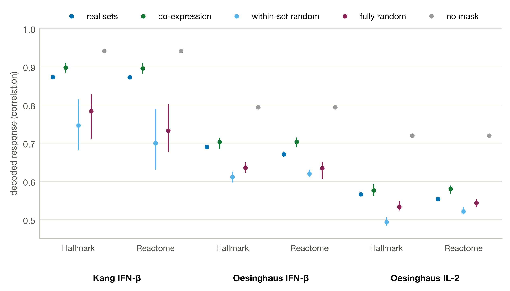

**Supplementary Figure 4. Decoded response of every variant in the six benchmarks.** Each point is the mean of 10 seeds and the line the range over seeds.

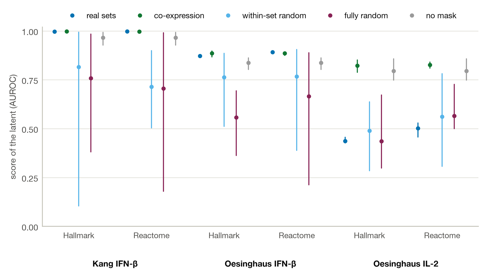

**Supplementary Figure 5. Score of the named latent in the six benchmarks.** AUROC of the latent for stimulated against control cells, averaged over cell types. For the gene set mask it is the latent named after the known-answer set and for the two random masks it is the latent at the same position, which holds a random set. The co-expression and no-mask variants have no names, so the best latent is scored, chosen on validation cells. Points are means of 10 seeds and lines the range.

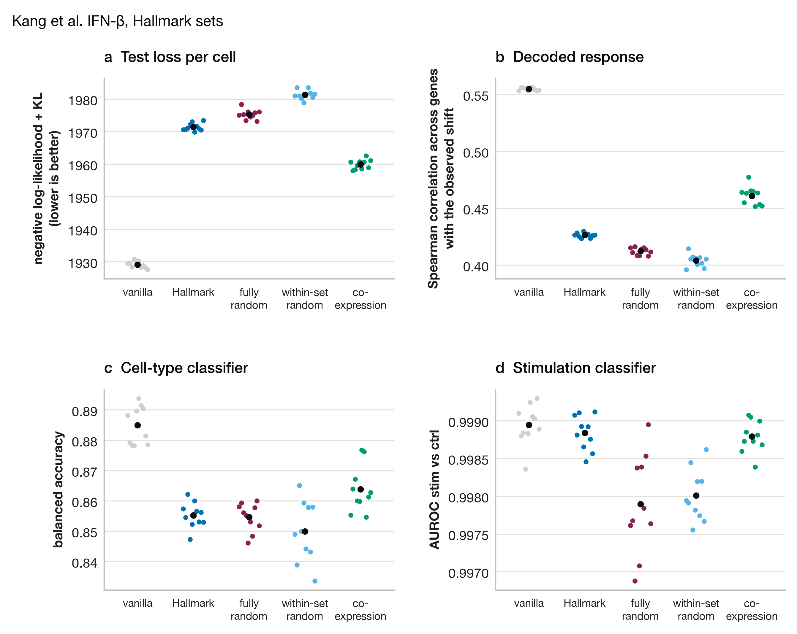

**Supplementary Figure 6. Kang et al. interferon-β, Hallmark sets.** a to d, the four measures that choose no latent (one dot per seed, bar at the mean).

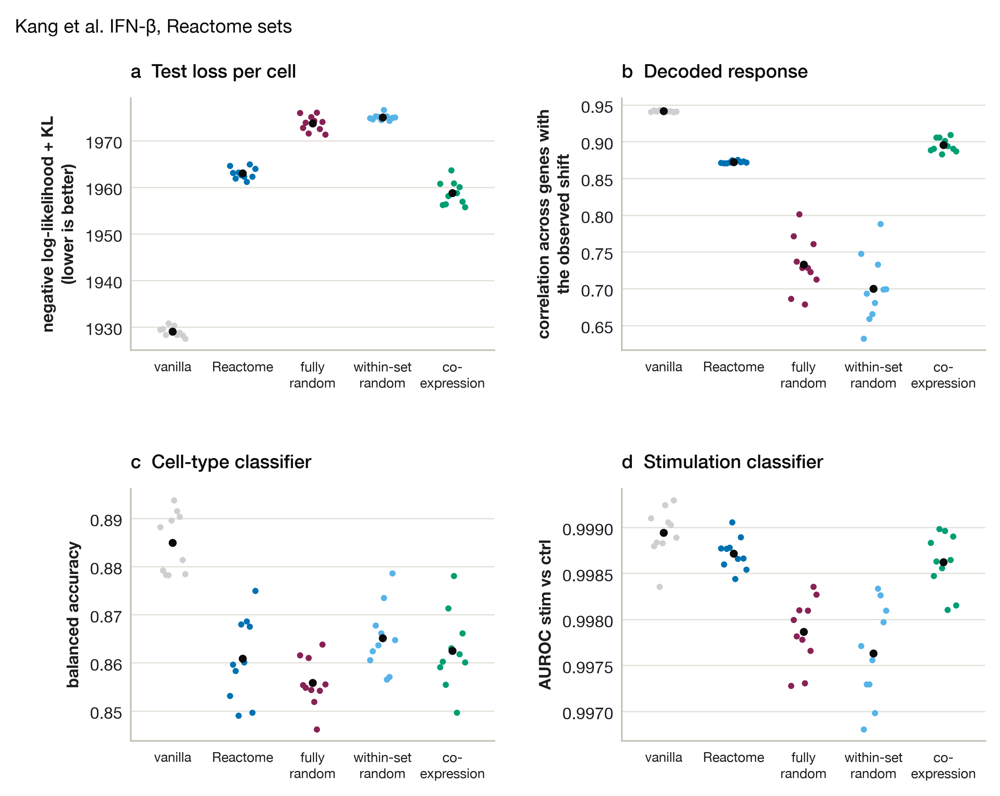

**Supplementary Figure 7. Kang et al. interferon-β, Reactome sets.** a to d, the four measures that choose no latent (one dot per seed, bar at the mean).

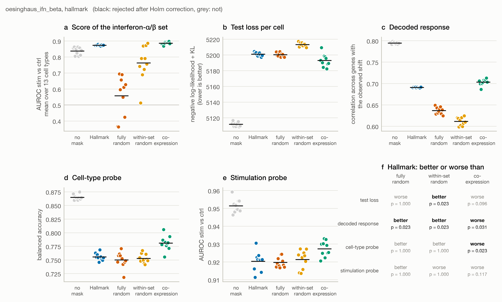

**Supplementary Figure 8. Theis et al. interferon-β, Hallmark sets.** a to d, the four measures that choose no latent (one dot per seed, bar at the mean).

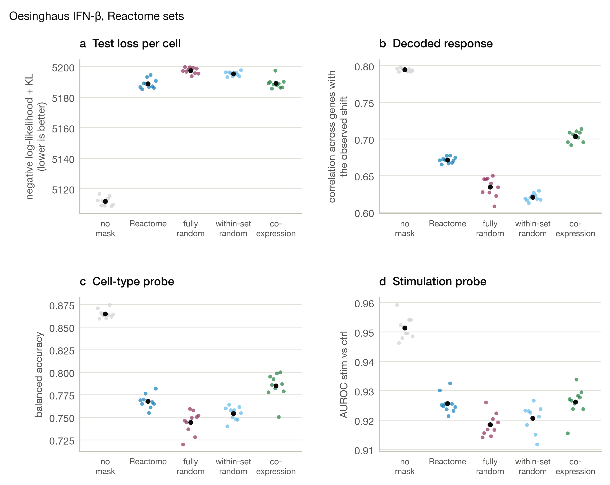

**Supplementary Figure 9. Theis et al. interferon-β, Reactome sets.** a to d, the four measures that choose no latent (one dot per seed, bar at the mean).

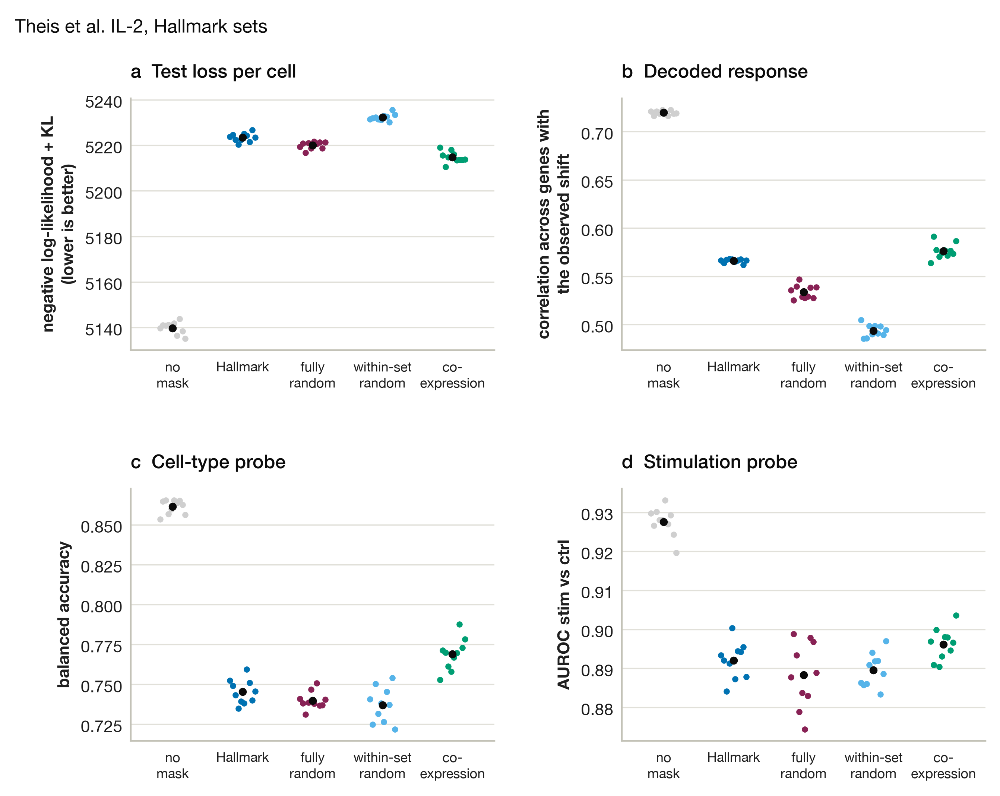

**Supplementary Figure 10. Theis et al. IL-2, Hallmark sets.** a to d, the four measures that choose no latent (one dot per seed, bar at the mean).

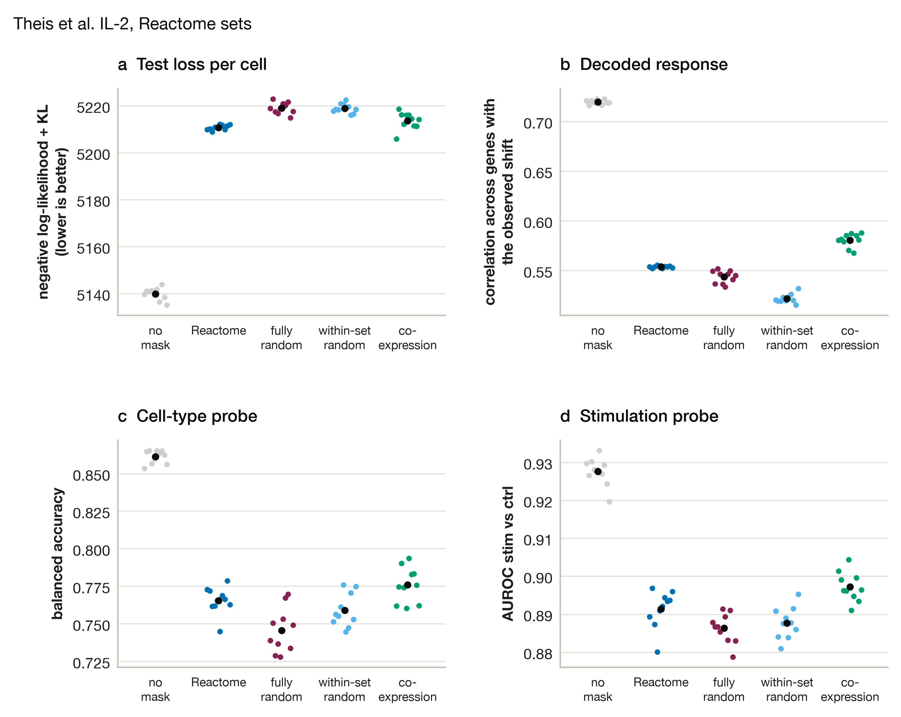

**Supplementary Figure 11. Theis et al. IL-2, Reactome sets.** a to d, the four measures that choose no latent (one dot per seed, bar at the mean).

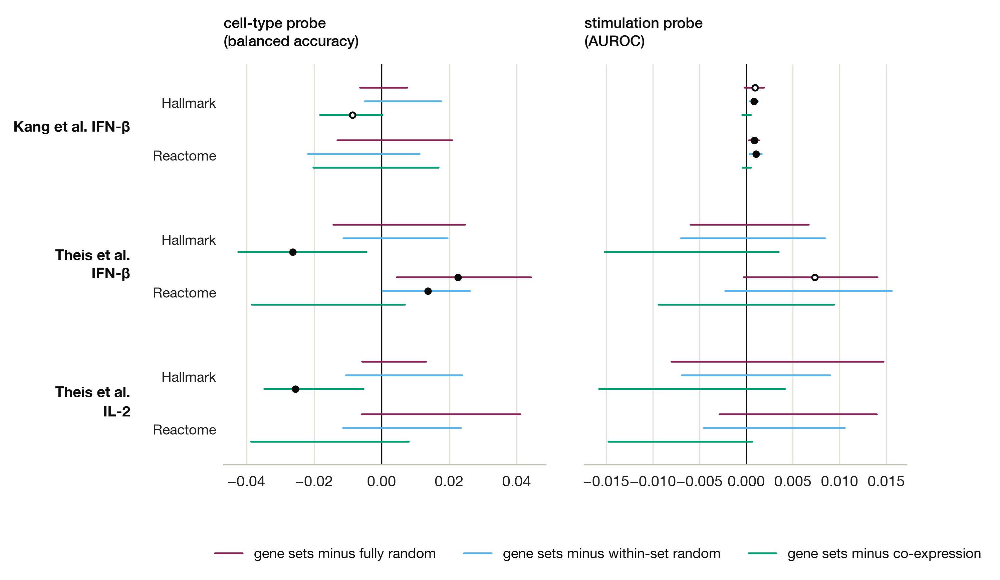

**Supplementary Figure 12. Gene sets against the other masks in the cell-type and stimulation probes, six benchmarks.** Each line is the interval of the paired difference over 10 seeds (gene sets minus the other mask, at the Bonferroni level), so a line right of zero means the gene sets are better. Each line is drawn in the colour of the mask it is compared with, and a black dot at the median marks an adjusted p below 0.05. The dot is open when the interval reaches zero.
